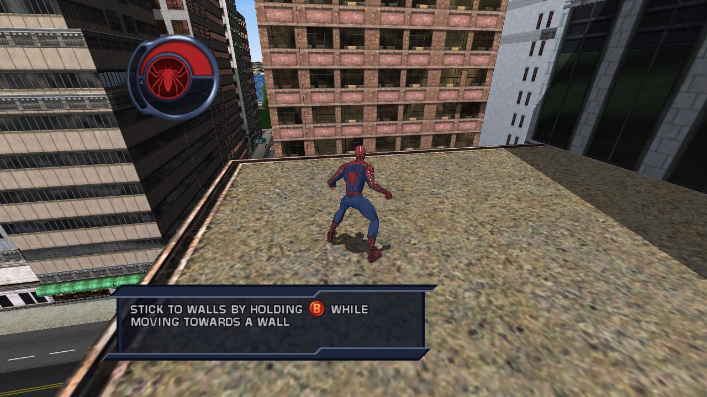
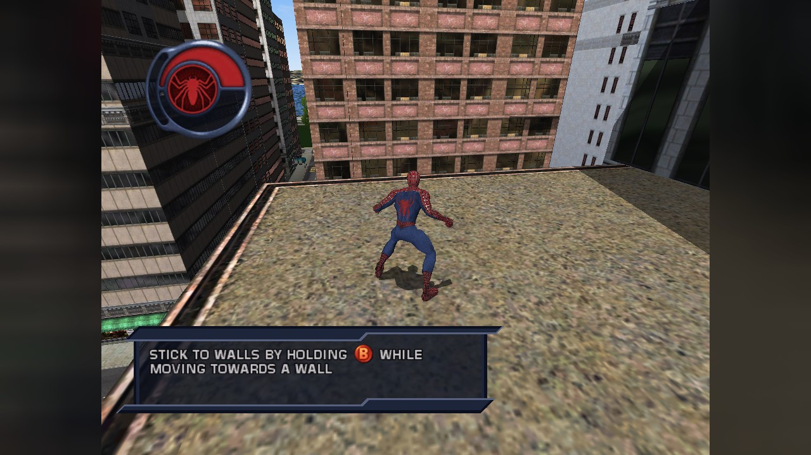
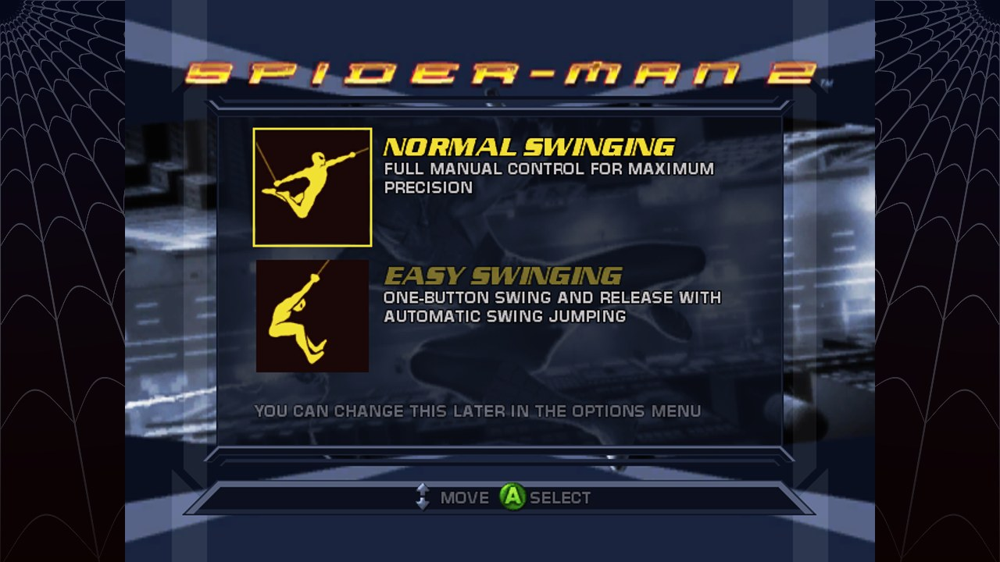
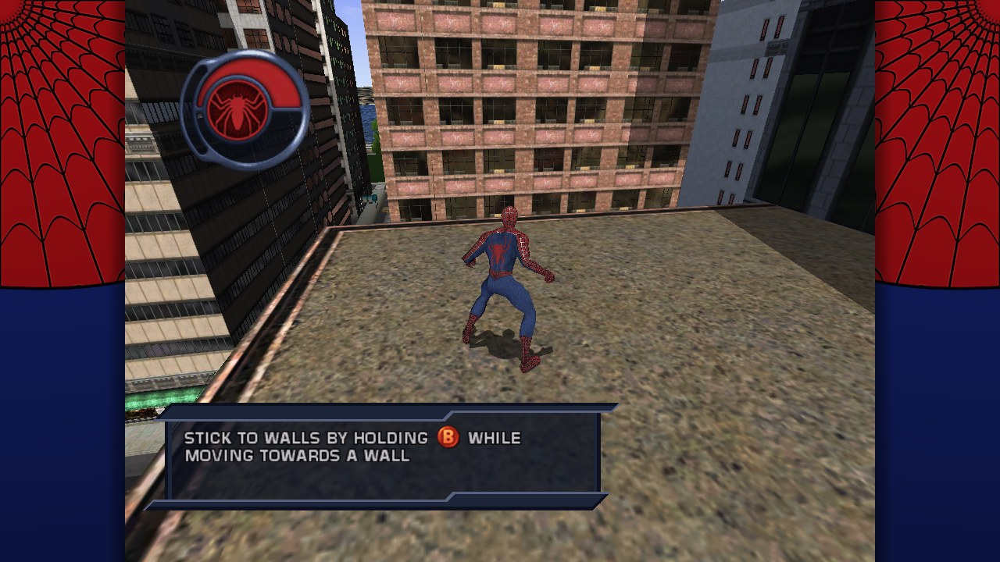

<div align="center">

[](README.md)
[](README.es.md)


# Spider-Man 2 (Xbox) para Nintendo Switch

**Un port homebrew no oficial de la versión de *Spider-Man 2* para la Xbox original (Treyarch, 2004) a Nintendo Switch.**<br>
El código del propio juego, recompilado de antemano para el procesador de la Switch, con el sistema de la Xbox
reconstruido a su alrededor. Trae tu propia copia del juego, compila el port a partir de ella una vez y
balancéate por Nueva York.

[](../../releases)
[](../../releases)


[](LICENSE)

[Instalar](#cómo-instalar) · [Controles](#controles) · [Menú de depuración](#menú-de-depuración) · [Estado](#estado) · [Preguntas frecuentes](#preguntas-frecuentes) · [Solución de problemas](docs/INSTALL.es.md#solución-de-problemas) · [Cambios](CHANGELOG.md) · [Cómo funciona](docs/TECHNICAL.md)

</div>

> [!IMPORTANT]
> **No se incluye ningún archivo del juego, ni en este repositorio ni en las versiones publicadas.**
> Necesitas tu propia copia de *Spider-Man 2* para la **Xbox original**, y compilas el port a partir de
> ella en tu computador (un doble clic en Windows, un comando en Linux). Por favor, no pidas archivos del juego en los issues y nunca
> los subas a ningún sitio, ni el `.nro` que compiles: contiene código hecho a partir del juego.
>
> Este port es **solo para la versión de la Xbox original (2004)**. Las versiones de PlayStation 2,
> GameCube, PC, Game Boy Advance, Nintendo DS y PSP son programas distintos y no sirven, y tampoco los
> juegos de *Spider-Man* más nuevos.

> [!NOTE]
> **Jugable en la Switch.** El port se ha jugado en una Switch Lite, en modo portátil: la 0.1.0 iba fluida a 480p,
> al propio ritmo del juego de 30 imágenes por segundo, con su música, efectos de sonido y voces. Se reportó que la
> 0.2.0 y la 0.2.1 iban lentas y se congelaban, sobre todo en 16:9: sus registros muestran al juego esperando a la
> tarjeta SD. La 0.2.2 y la 0.2.3 lo arreglan, y los [reportes](#se-buscan-testers) sobre cómo va son bienvenidos,
> igual que sobre jugar en el dock, que todavía no se ha comprobado en una consola. Antes de la 0.2.3 las partidas
> guardadas no cargaban.

> [!TIP]
> **Novedades de la 0.2.3: las partidas guardadas cargan, y el 16:9 no se congela.** Las partidas se guardaban pero
> nunca se podían cargar ("unable to load saved game"): ahora cargan, también las que ya tienes en la tarjeta, y se
> guarda una copia en `sdmc:/config/SpiderMan2Xbox/save/` por si una actualización reemplaza la carpeta. Además, los
> registros de un tester con la 0.2.1 mostraban el 16:9 congelándose hasta 4 segundos mientras el juego esperaba a
> que la tarjeta SD escribiera el registro: ningún hilo del juego escribe ya en la tarjeta.
>
> **Novedades de la 0.2.2: 16:9 sin el bajón.** En 16:9 el port escribía una línea en su registro de la tarjeta SD
> varias veces por imagen, y el juego esperaba cada escritura. Eso se acabó, y ninguna línea del registro espera ya
> a la tarjeta. Y una decoración nueva para el 4:3: **suit sides**, la telaraña con los colores del traje, rojo, azul
> y negro.
>
> **Novedades de la 0.2.1: más rápida.** El port pone los relojes para el juego por sí solo (**Auto**, el nuevo
> valor de fábrica), mantiene el HUD en 4:3 con 16:9 con mucho menos costo, y a 720p y 1080p solo agranda la imagen
> principal. 1080p ahora es para jugar en el dock.
>
> **Novedades de la 0.2.0**
> - **Imagen más nítida**: dibuja el juego, con sus videos, a **720p** (píxel a píxel en la pantalla portátil) o
>   **1080p**, desde el menú de depuración, en vez de los 480p de la Xbox.
> - **Pantalla completa 16:9, sin estirar nada**: el juego trae una cámara panorámica propia que Treyarch nunca
>   activó. El port la enciende: se ve más ciudad a los lados, y el HUD, los menús y los videos conservan su forma
>   4:3 en el centro.
> - **O 4:3 con algo a los lados** en vez de franjas negras: la imagen desenfocada o una telaraña.
> - **Vibración** en los Joy-Con y el Pro Controller: Off, Low, Medium o High. Si el juego deja una vibración
>   encendida, se apaga sola a los 2 segundos.
> - **Escalado más nítido** y **filtrado anisotrópico**, para videos más definidos y calles nítidas a lo lejos.
>
> Todos los detalles están en la [lista de cambios](CHANGELOG.md) (en inglés).

## Capturas

<table>
  <tr>
    <td colspan="2" align="center"></td>
  </tr>
  <tr>
    <td colspan="2" align="center"><sub>La primera azotea, al atardecer</sub></td>
  </tr>
  <tr>
    <td colspan="2" align="center"></td>
  </tr>
  <tr>
    <td colspan="2" align="center"><sub>Nuevo en la 0.2.0: la cámara 16:9 propia del juego, a 720p. Más ciudad a los lados, el HUD conserva su forma</sub></td>
  </tr>
  <tr>
    <td width="50%"></td>
    <td width="50%"></td>
  </tr>
  <tr>
    <td align="center"><sub>4:3 con la imagen desenfocada a los lados</sub></td>
    <td align="center"><sub>4:3 con una telaraña a los lados</sub></td>
  </tr>
  <tr>
    <td colspan="2" align="center"></td>
  </tr>
  <tr>
    <td colspan="2" align="center"><sub>Nuevo en la 0.2.2: 4:3 con la telaraña con los colores del traje a los lados</sub></td>
  </tr>
  <tr>
    <td width="50%"></td>
    <td width="50%"></td>
  </tr>
  <tr>
    <td align="center"><sub>La pantalla de título</sub></td>
    <td align="center"><sub>La misma con la consola en español</sub></td>
  </tr>
  <tr>
    <td width="50%"></td>
    <td width="50%"></td>
  </tr>
  <tr>
    <td align="center"><sub>Eligiendo el control del balanceo</sub></td>
    <td align="center"><sub>El menú de depuración (ZL + ZR + −) y el contador; los números son un ejemplo</sub></td>
  </tr>
  <tr>
    <td width="50%"></td>
    <td width="50%"></td>
  </tr>
  <tr>
    <td align="center"><sub>La pantalla de arranque del port, hasta que el juego dibuja</sub></td>
    <td align="center"><sub>Si no encuentra una copia que sirva, dice qué poner y dónde</sub></td>
  </tr>
  <tr>
    <td colspan="2" align="center"></td>
  </tr>
  <tr>
    <td colspan="2" align="center"><sub>El ícono del port en el Homebrew Menu</sub></td>
  </tr>
</table>

<p align="center"><sub>Las capturas del juego vienen de la versión de prueba para PC del port, que ejecuta el mismo
código recompilado y el mismo renderizador por GPU que la versión de Switch (sobre el Mesa del PC en vez del de la
Switch), con la disposición de pantalla de la versión de Switch: la imagen del juego en la pantalla de
1280×720 de la Switch. Las pantallas y el menú del port los dibuja el código de pantalla de la versión de Switch,
ejecutado en el PC.</sub></p>

## Características

- **El código real del juego, recompilado, no emulado.** Las 26.876 funciones del código x86 del juego se
  traducen a C++ de antemano y se compilan para el procesador ARM de la Switch. El kernel de la Xbox,
  Direct3D 8, DirectSound y los controles se reconstruyen como código nativo de Switch
  ([cómo funciona](#cómo-funciona)).
- **Lo dibuja la GPU de la Switch.** Lo que el juego dibuja con Direct3D 8 se convierte en OpenGL para el
  chip gráfico de la Switch: sus programas de vértices y combinadores de píxeles se traducen a shaders, y sus
  texturas se decodifican una vez y se guardan, en un hilo de renderizado junto al del juego.
- **A 480p, 720p o 1080p.** Todas las superficies que dibuja el juego se agrandan por igual, así que toda la
  imagen es más nítida, videos incluidos, con escalado más nítido y filtrado anisotrópico si quieres.
- **Pantalla completa sin estirar.** La cámara 16:9 oculta del propio juego muestra más ciudad a los lados; el
  HUD, los menús y los videos se quedan en 4:3. O deja el 4:3, con los lados negros, desenfocados, con telaraña o con los colores del traje.
- **Vibración** en los Joy-Con y el Pro Controller, con la fuerza que elijas, y nunca se queda encendida.
- **Tu copia en el formato que tengas.** Una imagen de disco (`.iso` o `.xiso`, una XISO recortada o un
  volcado completo del disco), las imágenes comprimidas `.cci` (Cerbios) y `.cso` (StellarOS) que hace
  Repackinator, cualquiera de ellas dividida en partes para una tarjeta FAT32, o los archivos del disco.
- **Se compila a partir de tu copia con un doble clic.** En Windows, `build-windows.cmd` prepara todo lo que
  necesita y te pide tu juego; en Linux es un solo comando. Comprueba que tu copia sea la edición compatible, la
  recompila, compila el `.nro` y arma la carpeta de la tarjeta SD con tu juego dentro.
- **En tu idioma.** El juego toma el idioma de la consola: menús y subtítulos en inglés, español, francés,
  alemán o italiano, con los textos de tu disco.
- **Un menú de depuración** (**ZL + ZR + −**) con la resolución, la forma de la pantalla, la vibración, un
  contador de imágenes por segundo, los relojes de CPU, GPU y memoria de la Switch (Auto de fábrica, y solo
  velocidades que usan los perfiles de Nintendo, devueltas en el menú HOME y al salir), el idioma, el volumen y el renderizador. Se guarda
  en `settings.ini`.
- **Dice qué está mal.** Falta la carpeta data, hay un archivo comprimido que extraer, una imagen de Xbox
  360, otra edición del juego: la pantalla lo explica con palabras sencillas.
- **Pensado para las pruebas.** El registro llega a la tarjeta SD varias veces por segundo, así que
  sobrevive a una consola congelada, y una línea de estado cada 2 segundos dice qué está haciendo cada hilo
  del juego. Los cierres inesperados dejan un informe. La pantalla de arranque también puede mostrar las
  últimas líneas del registro (el registro de arranque del menú de depuración).
- **Tus partidas en una carpeta**, `save/`, aparte de la caché: se respaldan copiando una sola carpeta, y se
  conservan entre actualizaciones, con una copia en `sdmc:/config/SpiderMan2Xbox/save/` que vuelve sola si alguna
  vez se reemplaza la carpeta.
- **Controles asignados por posición**, para que los botones que muestra el juego estén donde tus dedos
  los esperan.
- **Totalmente sin conexión.** El port no usa la red.

## Qué necesitas

| | Qué |
|---|---|
| **Consola** | Una Nintendo Switch, Switch OLED o Switch Lite con [Atmosphère](https://github.com/Atmosphere-NX/Atmosphere) y el Homebrew Menu. Usa emuMMC y guarda una copia de seguridad de tu tarjeta SD. |
| **Juego** | Tu propio *Spider-Man 2* para la **Xbox original**, la edición cuyo `default.xbe` tiene el SHA-1 `853bcb253c5baea2d7e2d9b59e5888b4c87bb402` (ID de título `4156002B`, versión 4). Como imagen de disco o como los archivos del disco, unos 1,7 GB. `build.sh` lo comprueba por ti. |
| **Computador** | Windows 10/11 (el compilador prepara solo WSL, el Linux que Windows puede instalar) o Linux, para compilar el port una vez. Unos 2 GB de espacio y de 10 a 30 minutos. En macOS no está probado. |
| **Tarjeta SD** | Unos 2 GB libres. FAT32 o exFAT (en FAT32, una imagen de disco de más de 4 GB tiene que ir dividida). |

## Cómo instalar

> [!TIP]
> **¿Nuevo en el homebrew de Switch?** Primero prepara tu consola con firmware personalizado (Atmosphère)
> y el Homebrew Menu: la guía de la comunidad [switch.hacks.guide](https://switch.hacks.guide/) lo explica
> paso a paso (en inglés). ¿No sabes qué significan XBE, XISO, CCI o WSL? Mira el [glosario](docs/INSTALL.es.md#glosario).


1. **Ten tu juego como archivos.** Una imagen de tu propio disco, o los archivos del disco. Las unidades de
   DVD de PC no leen los discos de la Xbox original: [cómo conseguirlos](docs/INSTALL.es.md#cómo-conseguir-tu-juego).
2. **Compila el port.** Descarga `SpiderMan2-2004-NX-0.1.0.zip` de la página de [Releases](../../releases)
   (en **Assets**) y descomprímelo. Luego:
   - **En Windows:** haz doble clic en **`build-windows.cmd`** y elige tu juego. La primera vez prepara WSL y
     las herramientas solo ([paso a paso](docs/INSTALL.es.md#en-windows)).
   - **En Linux:** ejecuta, en la carpeta, indicando dónde está tu juego (en Ubuntu o Debian instala sus
     herramientas la primera vez):
     ```sh
     bash build.sh --copy-game "/ruta/a/Spider-Man 2.iso"
     ```
   En los dos casos tarda de 10 a 30 minutos, más unos 10 la primera vez, y crea una carpeta con el port y tu
   juego dentro: `SD card` en Windows, `out/sd` en Linux.
3. **Copia a la tarjeta SD.** Copia la carpeta `switch` de esa carpeta a la raíz de tu tarjeta SD.
4. **Juega.** Mantén **R** mientras abres cualquier juego para entrar al Homebrew Menu, y elige
   **Spider-Man 2 (Xbox)**.

> [!WARNING]
> Abre siempre el Homebrew Menu con **R + un juego** (title takeover). Desde el Álbum, el homebrew solo
> recibe unos 440 MB de memoria, y el juego necesita unos 1,3 GB.

<details>
<summary><b>Así queda la carpeta en la tarjeta SD</b></summary>

```
sd:/switch/SpiderMan2Xbox/
├── SpiderMan2Xbox.nro    el port que compilaste (nunca lo compartas: contiene código hecho a partir del juego)
├── README.txt            la guía para jugar (en inglés)
├── game/                 TU juego, una de estas dos cosas:
│   ├── Spider-Man 2.iso      una imagen de disco (.iso .xiso .cci .cso), o todas las partes de una dividida
│   └── default.xbe, data/    o los archivos del disco
├── save/                 TUS partidas: haz copias de esta carpeta
│   ├── progress/             las partidas del juego (el E:\UDATA de la Xbox para este juego)
│   └── data/                 lo que el juego guarda para sí en el disco duro de la Xbox (E:\TDATA)
├── cache/                el resto del disco duro de la Xbox y la lista de shaders: se puede borrar
├── logs/                 sm2_NNN.log y crash.txt: adjúntalos al reportar un error
└── settings.ini          los ajustes del menú de depuración (bórralo para volver a los recomendados)
```

</details>

La [guía de instalación completa](docs/INSTALL.es.md) explica cómo conseguir tu juego, cómo compilar en Windows
con WSL, cómo actualizar y la [solución de problemas](docs/INSTALL.es.md#solución-de-problemas).

### Actualizar

Compila la versión nueva igual que la anterior y copia su carpeta `out/sd/switch` encima de la vieja. Tus
carpetas `game/` y `save/` se quedan como están. ¿Vienes de una versión anterior a la 0.1.0, que lo guardaba todo
en `hdd/`? En el primer arranque tus partidas pasan solas a `save/` y el resto de `hdd/` se convierte en `cache/`.

## Controles

El juego muestra los botones del control de la Xbox. Están asignados por **posición**, así que el botón que
pide el juego está donde está en el control de la Xbox:

| Xbox | Switch | | Xbox | Switch |
|---|---|---|---|---|
| A (abajo) | **B** | | Gatillo izquierdo / derecho | **ZL** / **ZR** |
| B (derecha) | **A** | | Botón blanco / negro | **L** / **R** |
| X (izquierda) | **Y** | | Start / Back | **+** / **−** |
| Y (arriba) | **X** | | Palancas, cruceta | lo mismo |

Mantén **+ y −** a la vez durante un segundo para salir. Mantén **ZL + ZR** y pulsa **−** para el
[menú de depuración](#menú-de-depuración) del port.

Para saber de dónde viene un problema, mantén uno de estos mientras arranca el port: **L** quita el sonido,
**R** usa el renderizador antiguo por CPU (una imagen fija cada pocos segundos, sin el chip gráfico), **ZR**
deja el trabajo gráfico en el propio hilo del juego (sin hilo de renderizado). Valen solo para ese arranque.

## Menú de depuración

Mantén **ZL + ZR** y pulsa **−** (en cualquier orden) para abrirlo; lo mismo, **B** o **+** lo cierran.
**Arriba/Abajo** elige un ajuste, **Izquierda/Derecha** o **A** lo cambian, y también funciona la pantalla
táctil. Mientras está abierto, el juego no recibe los botones (pulsa **+** antes si quieres pausar el juego).
Los cambios se guardan al momento en `settings.ini`, junto al `.nro`. El menú está en inglés.

| Ajuste | Opciones | Qué hace |
|---|---|---|
| Language (idioma) | Auto, English, Español, Français, Deutsch, Italiano | Los menús y subtítulos del juego. Auto sigue a la consola; un idioma que el juego no tiene es inglés. Las voces son en inglés en todos. Desde el siguiente arranque. |
| Resolution (resolución) | 480p (la de la consola), 720p, 1080p (docked: en el dock) | Con cuántos píxeles se dibujan el juego y sus videos. 720p llena la pantalla portátil píxel a píxel; 1080p, en el dock, se dibuja más grande y se reduce, con bordes más suaves (en modo portátil dibuja 720p, la de la pantalla). Más trabajo para la GPU, que el reloj Auto de la GPU sube. |
| Screen (pantalla) | 4:3 black sides, 4:3 blurred sides, 4:3 web sides, 4:3 suit sides, 16:9 full screen | La imagen conserva su forma. 16:9 usa la cámara panorámica propia del juego (más ciudad a los lados); el HUD, los menús y los videos se quedan en 4:3 en el centro. Los lados del 4:3 pueden ser negros, la imagen desenfocada, una telaraña o la telaraña con los colores del traje (rojo, azul y negro). |
| Upscaling (escalado) | Smooth, Sharp | Cómo se agrandan los videos y la imagen: Sharp conserva más detalle (Catmull-Rom), Smooth es el aspecto más suave de una TV. |
| Texture filtering (filtrado) | Standard, Anisotropic 4x, 8x, 16x | Las calles y fachadas vistas de lado se ven nítidas a lo lejos. Mucho más trabajo para el chip gráfico en la ciudad: si bajan las imágenes por segundo, vuelve a Standard. |
| Vibration (vibración) | Off, Low, Medium, High | La vibración del juego en los Joy-Con o un Pro Controller (la Switch Lite no tiene motor propio). Si el juego deja una vibración encendida, se apaga a los 2 segundos, y no vibra con el menú abierto ni en el menú HOME. |
| CPU clock | Auto (1785 MHz), Stock (1020 MHz), 1224, 1428, 1581, 1785 MHz | El código traducido del juego y el controlador gráfico corren en la CPU. Auto la deja en 1785 MHz mientras corre el juego. |
| GPU clock | Auto, Stock, 307.2, 384, 460.8, 614.4, 768 MHz | El chip gráfico. Auto es 460,8 MHz (lo más alto que usa Nintendo en modo portátil) a 480p en modo portátil, y 768 MHz a 720p y en el dock. |
| Memory clock | Auto (1600 MHz), Stock, 1331.2, 1600 MHz | 1600 MHz es el reloj de memoria en el dock; Nintendo también lo usa en modo portátil. |
| Frame-rate counter | Off, FPS, Full | Arriba a la izquierda. Full añade el tiempo de cada imagen, las llamadas de dibujo, los relojes y la memoria. |
| Sound volume | 100% a 25%, Off | El sonido del juego, antes del volumen de la consola. |
| Renderer | GPU, CPU | CPU es muchas veces más lento: solo para saber si un fallo de la imagen viene del renderizador por GPU. Desde el siguiente arranque. |
| Render thread | On, Off | El trabajo gráfico en un núcleo propio (el sonido tiene un tercero). Desde el siguiente arranque. |
| Start-up log | Off, On | Las últimas líneas del registro en la pantalla de arranque mientras carga el juego, para una foto si no arranca. Desde el siguiente arranque. |

Los relojes solo ofrecen velocidades que usan los perfiles de rendimiento de Nintendo. Los de la consola
vuelven mientras el port está en el menú HOME y al cerrarlo, y el port vuelve a poner los tuyos después de
conectar al dock o del modo reposo. "Restore recommended settings" deja todo como al principio (el idioma de la
consola, 480p, 4:3 con lados negros, escalado suave, filtrado estándar, vibración media, relojes Auto, sin
contador, volumen completo, el renderizador por GPU en su propio hilo). Los ajustes de imagen, los relojes y la
vibración cambian al momento, mientras juegas. Los relojes Auto gastan más batería que los de la consola: elige
Stock para que la batería dure más.

## Estado

> [!NOTE]
> **Jugable.** Jugado en una Switch Lite en modo portátil. Como con cualquier homebrew, haz una copia de
> seguridad de tu tarjeta SD y usa emuMMC.

| Parte | Estado |
|---|---|
| El código del juego en el procesador de la Switch | ✅ Recompilado y compilado; funciona en una Switch Lite |
| Leer tu copia: imágenes de disco y archivos | ✅ Todos los formatos comprobados byte a byte contra los archivos extraídos, en PC y en ARM |
| Jugar en una Switch | ✅ Jugado en una Switch Lite, en modo portátil |
| Velocidad | 🧪 La 0.1.0 iba fluida en una Switch Lite a 480p; se reportó que la 0.2.0 y la 0.2.1 iban lentas, sobre todo en 16:9, donde sus registros muestran al juego esperando a la tarjeta SD. La 0.2.2 quita las escrituras en la tarjeta del 16:9 y la 0.2.3 saca de los hilos del juego toda escritura en la tarjeta (los relojes Auto, un 16:9 y una resolución más ligeros llegaron en la 0.2.1); en 4:3 a 720p la 0.2.1 de un tester se mantuvo en 30 imágenes por segundo: falta confirmarlo en una consola |
| Imagen | ✅ La GPU de la Switch con OpenGL, imagen por imagen |
| 720p, 1080p, 16:9 | 🧪 Nuevo en la 0.2.0, más ligero en la 0.2.1: comprobado en la versión de prueba para PC; falta medir qué tan rápido va en una consola |
| Vibración | 🧪 Nuevo en la 0.2.0: necesita Joy-Con o un Pro Controller; aún no se ha probado en una consola |
| Menús, cinemáticas, la ciudad | ✅ En una Switch Lite y en la versión de prueba para PC |
| Sonido | ✅ Música, efectos de sonido y voces, en una Switch Lite |
| Controles | ✅ Asignados por posición |
| En el dock (TV) | 🧪 Todavía no se ha probado en una consola |
| Partidas | ✅ Guardar y cargar comprobado en la versión de prueba para PC en la 0.2.3 (antes, las partidas se guardaban pero nunca cargaban); en `save/` en la tarjeta SD, con una copia en `sdmc:/config/SpiderMan2Xbox/save/` |
| Idioma | ✅ El de la consola: textos en inglés, español, francés, alemán o italiano (voces en inglés, como en el disco) |
| Menú de depuración, contador | ✅ En una Switch Lite; los relojes solo ofrecen velocidades que usan los perfiles de Nintendo |
| En línea | ❌ Nada: el port no usa la red |

**Problemas conocidos**
- Jugar en el dock con la TV todavía no se ha comprobado en una consola. Antes de la 0.2.3 las partidas guardadas no
  cargaban.
- Vistos en una consola, todavía sin arreglar: **el balanceo con la telaraña muestra una sola animación**, y
  **reflejos incorrectos en las ventanas de los edificios**. Un vídeo corto de cada uno, con la carpeta `logs`,
  mostraría qué arreglar (las líneas `swing:` del log dicen qué animaciones de balanceo elige el juego).
- La primera vez que pasas por un sitio nuevo puede haber un tirón breve mientras se preparan los shaders; se guardan para la siguiente vez.
- En español, francés, alemán e italiano las voces son en inglés: el disco solo trae las inglesas.
- Solo funciona la edición de arriba: otras ediciones necesitan su propia configuración del recompilador.

En la [lista de cambios](CHANGELOG.md) (en inglés) está lo que cambió en cada versión.

## Se buscan testers

El port se juega en una Switch Lite en modo portátil. Lo que más ayuda ahora son más consolas y más partes del
juego. Los reportes en español o en inglés ayudan mucho, con la carpeta `logs`:

| Qué | Cómo ayudar |
|---|---|
| 📺 **En el dock** | Juega con la consola en el dock, en una TV, y cuenta cómo va (el contador del menú de depuración muestra las imágenes por segundo). |
| 🖼️ **720p, 1080p, 16:9** | Prueba las nuevas resoluciones y formas de pantalla: las imágenes por segundo en una calle concurrida, y cualquier cosa fuera de lugar (una parte del HUD o un marcador que no esté donde debe en 16:9). |
| 📳 **Vibración** | Con Joy-Con o un Pro Controller: ¿se siente bien, y alguna vez se queda vibrando sola? |
| 🕸️ **El balanceo y las ventanas** | Un vídeo corto balanceándote con la telaraña (¿Spider-Man usa siempre el mismo balanceo?) y de ventanas de edificios con reflejos que se vean mal, con la carpeta `logs`. |
| 💾 **Partidas** | Guarda en el juego, sal, vuelve a abrirlo y carga: ¿vuelve tu progreso? |
| 🎮 **Más adelante** | ¿Hasta dónde llegaste? Cualquier cosa que se detenga, se congele o se vea mal por el camino. |
| 🧊 **Se congela** | Si la consola se congela, toma una foto, reiníciala y envía la carpeta `logs` y los archivos más nuevos de `atmosphere/crash_reports/`. Luego prueba una vez manteniendo **L** al arrancar (sin sonido), y otra manteniendo **R** (el renderizador por CPU). |
| 🎨 **La imagen** | Una foto de lo que se dibuje mal, y la carpeta `logs`: sus líneas `perf:` dicen a qué velocidad va y en qué se va el tiempo. |
| 💿 **El formato de tu imagen** | Si tu `.cci`, `.cso` o imagen dividida no es aceptada, envía el registro: dice por qué. |

Abre un [issue](../../issues/new/choose): el formulario pide todo lo necesario.

## Preguntas frecuentes

<details>
<summary><b>¿Es un emulador?</b></summary>

**No, al menos no para el código del juego.** Un emulador lee las instrucciones x86 del juego una por una
mientras se ejecuta (o las traduce sobre la marcha). Este port usa **recompilación estática**: cada función
del `default.xbe` del juego se traduce a C++ una sola vez, en tu computador, y ese C++ se compila como un
programa normal de Switch. La Switch ejecuta entonces la lógica del juego como código propio.

Lo que el juego le pide a la Xbox (el kernel, los archivos, los hilos, Direct3D 8, DirectSound, los
controles) lo responde el propio código del port, escrito para la Switch. La imagen funciona parecido a los
gráficos de un emulador moderno: los comandos de Direct3D del juego para la GPU de la Xbox se convierten en
OpenGL para la GPU de la Switch, con sus shaders traducidos. Mira [Cómo funciona](docs/TECHNICAL.md) (en inglés).
</details>

<details>
<summary><b>¿Por qué no hay una descarga lista para jugar?</b></summary>

Porque el `.nro` *es* el código del juego, traducido al procesador de la Switch. Compartirlo sería compartir
el juego. Por eso las versiones publicadas traen el código del port y el compilador, y tú haces el `.nro` a
partir de tu propia copia en tu computador. En Windows es un doble clic en `build-windows.cmd` (un comando en
Linux), y primero comprueba tu copia. Guarda para ti
el `.nro` que hagas.
</details>

<details>
<summary><b>¿Funciona con la versión de PlayStation 2, GameCube o PC?</b></summary>

No. Son programas distintos: cada versión de *Spider-Man 2* (2004) se hizo para su propia consola, y la
versión de PC es directamente otro juego. Este port funciona **solo con la versión de la Xbox original**. Los
juegos de *Spider-Man* más nuevos (por ejemplo *Marvel's Spider-Man 2*, de 2023) no tienen nada que ver.
</details>

<details>
<summary><b>¿Qué edición del juego de Xbox funciona?</b></summary>

La que tiene un `default.xbe` con el SHA-1 `853bcb253c5baea2d7e2d9b59e5888b4c87bb402` (ID de título
`4156002B`, versión 4), en inglés. `build.sh` lo comprueba y te avisa si la tuya es distinta. El código
recompilado corresponde exactamente a ese archivo; otra edición (de otra región, por ejemplo) necesitaría su
propia configuración del recompilador. Si tienes otra edición, ayuda abrir un issue con su SHA-1 (el
compilador lo muestra).
</details>

<details>
<summary><b>¿De dónde saco los archivos del juego?</b></summary>

De tu propio disco. Este proyecto no puede ayudar con eso, y los issues que pidan archivos del juego se
cerrarán. [Cómo conseguir tu juego](docs/INSTALL.es.md#cómo-conseguir-tu-juego) explica las formas habituales de
hacer una copia de tu propio disco.
</details>

<details>
<summary><b>¿Qué formatos de imagen de disco funcionan?</b></summary>

- **`.iso` / `.xiso`**: una XISO recortada (la que hace `extract-xiso`) o un volcado completo del disco (con la
  partición de video al principio, como los de Redump).
- **`.cci`**: las imágenes comprimidas que hace Repackinator para Cerbios.
- **`.cso`**: las imágenes comprimidas (versión 2, LZ4) que hacen Repackinator y `ciso` para StellarOS.
- Cualquiera de ellas **dividida** en partes (`nombre.1.iso`, `nombre.2.iso`, ... o `.1.cci`, `.1.cso`): pon
  todas las partes en la carpeta.
- O los **archivos** del disco: `default.xbe` y la carpeta `data`.

No se leen: archivos comprimidos `.zip`, `.7z` o `.rar` (extráelos primero), imágenes de Xbox 360, ni el CSO
viejo con zlib (versión 1) hecho para la PSP.
</details>

<details>
<summary><b>Mi tarjeta SD está en FAT32 y mi imagen pesa más de 4 GB</b></summary>

FAT32 no admite archivos de más de 4 GB. Usa una imagen dividida (Repackinator la divide solo, y el port lee
las partes como una sola), un `.cci` o `.cso` comprimido (este juego queda en unos 1,5 GB), o los archivos del
disco. O formatea la tarjeta en exFAT.
</details>

<details>
<summary><b>¿Va a velocidad completa?</b></summary>

Sí: en una Switch Lite en modo portátil se juega fluido, al ritmo propio del juego, 30 imágenes por segundo,
como en la Xbox. El contador del menú de depuración lo muestra en pantalla, y si algún sitio con mucho
movimiento baja de 30 puedes subir ahí el reloj de la CPU (hasta 1785 MHz, una velocidad que usan los perfiles de
Nintendo). En el dock todavía no se ha medido.
</details>

<details>
<summary><b>¿Puede llenar toda la pantalla? ¿Se estira?</b></summary>

Sí, y no. Pon **Screen** en **16:9 full screen** en el menú de depuración. El juego se hizo para TV 4:3, pero su
código tiene una cámara 16:9 que Treyarch nunca activó; el port la enciende y amplía su vista, así que ves más ciudad
a los lados y nada se estira. Lo que el juego dibuja plano en la pantalla (el HUD, los menús, los textos, los videos)
se queda en 4:3 en el centro. Si prefieres la imagen 4:3 original, los lados pueden ser negros, la imagen
desenfocada, una telaraña o la telaraña con los colores del traje: rojo, azul y negro.
</details>

<details>
<summary><b>¿Puede ir a más resolución?</b></summary>

Sí: **Resolution** en el menú de depuración dibuja el juego a 720p (la de la pantalla portátil) o, en el dock,
1080p en vez de los 480p de la Xbox, videos incluidos (1080p en modo portátil dibuja 720p: la pantalla no tiene más
píxeles). Es más trabajo para el chip gráfico de la Switch, que el reloj Auto de la GPU sube; si bajan las imágenes
por segundo, baja un paso. Los videos del disco son de 640×480, así que ganan
bordes más suaves más que detalle nuevo; **Upscaling: Sharp** los deja más definidos.
</details>

<details>
<summary><b>¿Vibra?</b></summary>

Con Joy-Con o un Pro Controller, sí: elige **Vibration** en el menú de depuración (Medium de fábrica). La Switch Lite
no tiene motor de vibración propio, así que en una Lite solo se siente con Joy-Con o un Pro Controller conectados. Si
el juego alguna vez deja una vibración encendida, se apaga sola a los 2 segundos.
</details>

<details>
<summary><b>¿Puedo jugar en español?</b></summary>

Sí. El juego toma el idioma de la consola: con la consola en español (de España o de Latinoamérica), francés,
alemán o italiano, sus menús y subtítulos salen en ese idioma, con los textos de tu disco. Las voces siguen en
inglés, porque el disco solo trae las inglesas. Para elegir otro idioma que el de la consola, usa el menú de
depuración (**ZL + ZR + −**) y vuelve a arrancar el port.
</details>

<details>
<summary><b>¿El port se conecta a internet? ¿Me pueden banear?</b></summary>

El port nunca se conecta a internet. Usar cualquier homebrew requiere firmware personalizado, lo que va
contra las condiciones de Nintendo y puede hacer que una consola sea baneada de los servicios en línea de
Nintendo. Lo habitual es usar el homebrew en un emuMMC y tener una copia de seguridad de tu tarjeta SD.
</details>

<details>
<summary><b>¿Dónde está mi partida y cómo la respaldo?</b></summary>

En `switch/SpiderMan2Xbox/save/`: el juego guarda sus partidas en `save/progress/` como lo haría en el disco
duro de la Xbox, y algunos datos propios en `save/data/`. El port además guarda una copia en
`sdmc:/config/SpiderMan2Xbox/save/`, al día unos segundos después de cada guardado: si al arrancar `save/progress`
está vacía (por ejemplo, una actualización que reemplazó toda la carpeta), la copia vuelve sola. Copia también la
carpeta `save` a un lugar seguro de vez en cuando. `cache/`, a su lado, se puede borrar cuando quieras. Para empezar
desde cero, elige **New Game** en el menú de guardado del juego, o borra `save/` y `sdmc:/config/SpiderMan2Xbox/`.
</details>

<details>
<summary><b>¿Puedo compilarlo en Windows sin WSL, o en una Mac?</b></summary>

El compilador es un script de Linux, así que en Windows funciona en WSL, el Linux gratuito de Microsoft:
`build-windows.cmd` lo instala si hace falta y hace el resto ([paso a paso](docs/INSTALL.es.md#en-windows)).
devkitPro también funciona en macOS, pero el script no se ha probado ahí.
</details>

## Cómo funciona

El juego es el programa x86 `default.xbe`, hecho para el Pentium III de la Xbox y su chip gráfico NV2A. El port:

1. **Recompila el código del juego de antemano** con `xbe_recomp`, del SDK
   [Xbox XBE Recomp](https://github.com/TGP482/XboxXBE-Recomp): cada función se convierte en C++, que se
   compila para la CPU ARM de la Switch con devkitA64.
2. **Reconstruye el sistema de la Xbox a su alrededor**: las 120 funciones del kernel que importa el juego,
   hilos y temporizadores, archivos (los del disco o los de la imagen de disco), Direct3D 8 con sus push buffers
   y programas de vértices, DirectSound y los controles, como código nativo.
3. **Acomoda el espacio de direcciones de 4 GB de la Xbox** en la memoria que puede tener un programa homebrew
   de Switch, en trozos de 256 MB.
4. **Dibuja** los comandos de Direct3D del juego con OpenGL en la GPU de la Switch (el driver de Mesa, de
   devkitPro): los programas de vértices y los combinadores de píxeles se convierten en shaders, y las texturas
   se decodifican una vez desde la memoria del juego.

Más en [docs/TECHNICAL.md](docs/TECHNICAL.md) (en inglés): el recompilador, la capa de Switch, los formatos de
imagen de disco, las versiones de prueba y la organización del código.

## Compilar desde el código fuente

`build.sh` hace todo: compila las herramientas de PC, recompila tu `default.xbe` y compila el `.nro` con las
herramientas `switch-dev` de [devkitPro](https://devkitpro.org/wiki/Getting_Started) y `switch-mesa` (OpenGL):

```sh
bash build.sh --copy-game "/ruta/a/tu/Spider-Man 2.iso"     # o la carpeta del juego, o default.xbe
```

En Windows, `build-windows.cmd` ejecuta el mismo compilador en WSL.

El resultado es `build-switch/SpiderMan2Xbox.nro`, ya armado para la tarjeta SD en `out/sd/`.
[docs/BUILDING.md](docs/BUILDING.md) (en inglés) tiene los detalles, la versión de prueba para PC que se usa para
desarrollar, las pruebas y cómo se publica una versión.

## Créditos

Gracias a quienes hicieron esto posible:

- **Treyarch** y **Activision**, que hicieron el juego. Por favor, apoya el original.
- [**Xbox XBE Recomp**](https://github.com/TGP482/XboxXBE-Recomp) de TGP482: el recompilador y el entorno de la
  Xbox sobre los que está hecho este port (en `sdk/`, con los cambios que se listan en [docs/TECHNICAL.md](docs/TECHNICAL.md)).
- [**Zydis**](https://github.com/zyantific/zydis) (decodificación de x86) y [**toml++**](https://github.com/marzer/tomlplusplus),
  que usa el recompilador.
- [**XbSymbolDatabase**](https://github.com/Cxbx-Reloaded/XbSymbolDatabase), [**Cxbx-Reloaded**](https://github.com/Cxbx-Reloaded/Cxbx-Reloaded)
  y [**xemu**](https://github.com/xemu-project/xemu): para encontrar las funciones del XDK, y como referencia de cómo
  se comportan la Xbox y su GPU.
- [**libnx**](https://github.com/switchbrew/libnx) y la comunidad de switchbrew, [**devkitPro**](https://devkitpro.org)
  (devkitA64, switch-tools, y el port para Switch de [**Mesa**](https://mesa3d.org) con el que dibuja el
  renderizador por GPU) y [**Atmosphère**](https://github.com/Atmosphere-NX/Atmosphere).
- [**sys-clk**](https://github.com/retronx-team/sys-clk): las velocidades de reloj de los perfiles de rendimiento de
  la Switch, a las que se ciñen los ajustes de reloj del menú de depuración.
- Los formatos de imagen de disco: [**extract-xiso**](https://github.com/XboxDev/extract-xiso),
  [**Repackinator** y XboxToolkit](https://github.com/Team-Resurgent/Repackinator) de Team Resurgent (CCI), y
  [**ciso**](https://github.com/antangelo/ciso) de antangelo (CSO), cuyos formatos lee el port; LZ4 de Yann Collet.

Lista completa con licencias: [THIRD_PARTY.md](THIRD_PARTY.md) (en inglés).

## Licencia

El código propio del port (`switch/`, `gl/`, `src/`, `tools/`, `config/`, `build.sh`) está bajo la [licencia MIT](LICENSE).
El SDK en `sdk/` mantiene su propia licencia MIT ([sdk/LICENSE](sdk/LICENSE)), y el resto del código de terceros,
la suya ([THIRD_PARTY.md](THIRD_PARTY.md)). El juego no está incluido y estas licencias no lo cubren de ninguna
forma.

## Aviso legal

Este es un proyecto no oficial hecho por fans. No está afiliado, respaldado ni patrocinado por Activision,
Treyarch, Marvel, Sony Pictures, Microsoft ni Nintendo. *Spider-Man* es una marca registrada de Marvel; Xbox es
una marca registrada de Microsoft; Nintendo Switch es una marca registrada de Nintendo. Aquí no se distribuye
ningún código ni dato del juego: necesitas tu propia copia del juego, y lo que compiles a partir de ella es solo
para ti.

Usar homebrew requiere firmware personalizado, lo que va contra las condiciones de servicio de Nintendo y puede
hacer que una consola sea baneada de los servicios en línea; esa decisión es tuya. El software se ofrece tal
cual, sin garantía (consulta la [LICENCIA](LICENSE)).

---

<div align="center">

Un proyecto de **SantiBros** · Si te gusta, dale una estrella al repositorio ⭐ y compártelo

</div>
