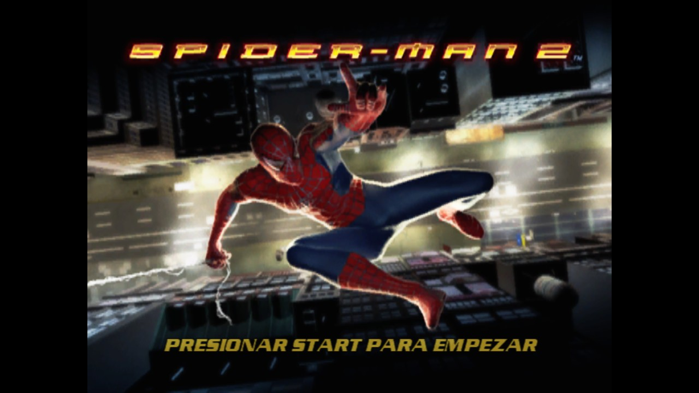
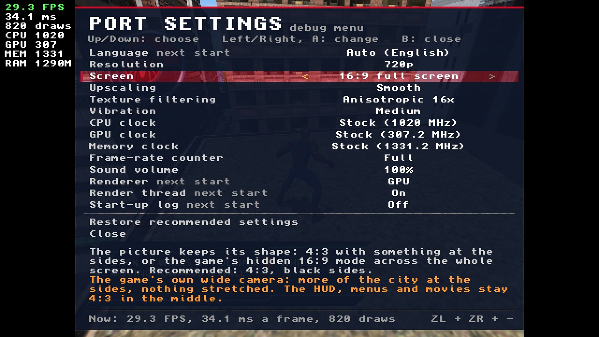
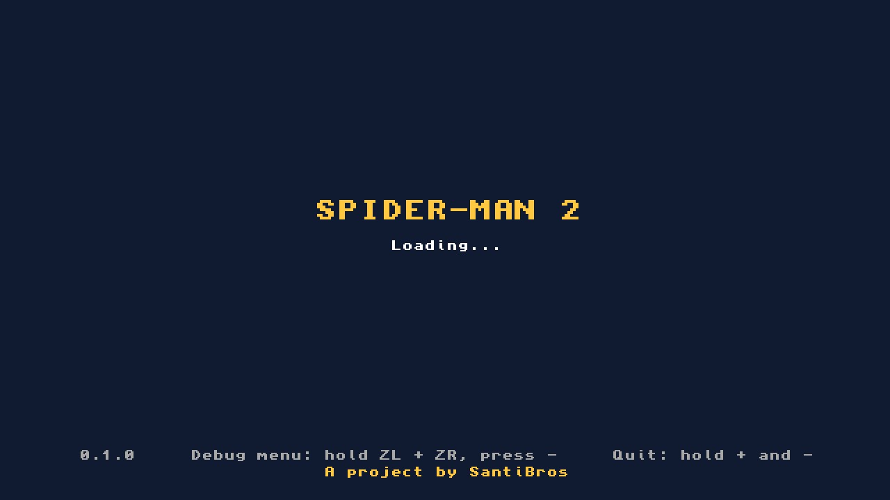
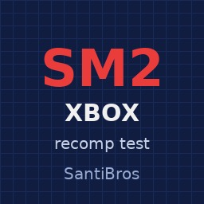
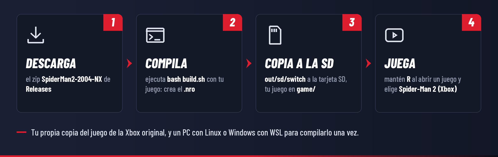

<div align="center">

[](README.md)
[](README.es.md)


# Spider-Man 2 (Xbox) para Nintendo Switch

**Un port homebrew no oficial de la versión de *Spider-Man 2* para la Xbox original (Treyarch, 2004) a Nintendo Switch.**<br>
El código del propio juego, recompilado de antemano para el procesador de la Switch, con el sistema de la Xbox
reconstruido a su alrededor. Trae tu propia copia del juego, compila el port a partir de ella una vez y
balancéate por Nueva York.

[](../../releases)
[](../../releases)


[](LICENSE)

[Instalar](#cómo-instalar) · [Controles](#controles) · [Menú de depuración](#menú-de-depuración) · [Estado](#estado) · [Preguntas frecuentes](#preguntas-frecuentes) · [Solución de problemas](docs/INSTALL.es.md#solución-de-problemas) · [Cambios](CHANGELOG.md) · [Cómo funciona](docs/TECHNICAL.md)

</div>

> [!IMPORTANT]
> **No se incluye ningún archivo del juego, ni en este repositorio ni en las versiones publicadas.**
> Necesitas tu propia copia de *Spider-Man 2* para la **Xbox original**, y compilas el port a partir de
> ella en tu computador (un solo comando). Por favor, no pidas archivos del juego en los issues y nunca
> los subas a ningún sitio, ni el `.nro` que compiles: contiene código hecho a partir del juego.
>
> Este port es **solo para la versión de la Xbox original (2004)**. Las versiones de PlayStation 2,
> GameCube, PC, Game Boy Advance, Nintendo DS y PSP son programas distintos y no sirven, y tampoco los
> juegos de *Spider-Man* más nuevos.

> [!WARNING]
> **Versión de prueba: todavía no se ha jugado en una Switch.** En la versión de prueba para PC del port, el
> juego pasa por sus menús, cinemáticas y primeras misiones en la ciudad, en cinco idiomas. En una Switch
> todavía no ha pasado de su arranque en las pruebas, así que todavía no se sabe a qué velocidad va ahí: la
> 0.1.0 trae un contador de imágenes por segundo y los relojes de la Switch en un menú de depuración para
> averiguarlo. Se buscan [testers](#se-buscan-testers).

> [!TIP]
> **Novedades de la 0.1.0**
> - **Un menú de depuración**: mantén **ZL + ZR** y pulsa **−** para los ajustes del port: un contador de
>   imágenes por segundo, los relojes de CPU, GPU y memoria de la Switch, el idioma, el volumen y el
>   renderizador, guardados en la tarjeta SD.
> - **En tu idioma**: el juego sigue el idioma de la consola, con sus menús y subtítulos en español, francés,
>   alemán o italiano (las voces siguen en inglés: el disco solo trae esas). O elige uno en el menú.
> - **Una pantalla de arranque limpia**: "Loading..." en vez del registro pasando (el registro se puede
>   volver a activar).
> - **Más rápido**: el hilo del juego necesita un 14% menos de tiempo de procesador por imagen (su código es más
>   pequeño y registra lo que dibuja con menos trabajo).
>
> Todos los detalles están en la [lista de cambios](CHANGELOG.md) (en inglés).

## Capturas

<table>
  <tr>
    <td colspan="2" align="center"></td>
  </tr>
  <tr>
    <td colspan="2" align="center"><sub>La primera azotea, al atardecer</sub></td>
  </tr>
  <tr>
    <td width="50%"></td>
    <td width="50%"></td>
  </tr>
  <tr>
    <td align="center"><sub>La pantalla de título</sub></td>
    <td align="center"><sub>La misma con la consola en español</sub></td>
  </tr>
  <tr>
    <td width="50%"></td>
    <td width="50%"></td>
  </tr>
  <tr>
    <td align="center"><sub>Eligiendo el control del balanceo</sub></td>
    <td align="center"><sub>El menú de depuración (ZL + ZR + −) y el contador; los números son un ejemplo</sub></td>
  </tr>
  <tr>
    <td width="50%"></td>
    <td width="50%"></td>
  </tr>
  <tr>
    <td align="center"><sub>La pantalla de arranque del port, hasta que el juego dibuja</sub></td>
    <td align="center"><sub>Si no encuentra una copia que sirva, dice qué poner y dónde</sub></td>
  </tr>
  <tr>
    <td colspan="2" align="center"></td>
  </tr>
  <tr>
    <td colspan="2" align="center"><sub>El ícono del port en el Homebrew Menu</sub></td>
  </tr>
</table>

<p align="center"><sub>Las capturas del juego vienen de la versión de prueba para PC del port, que ejecuta el mismo
código recompilado y el mismo renderizador por GPU que la versión de Switch (sobre el Mesa del PC en vez del de la
Switch), con la disposición de pantalla de la versión de Switch: la imagen 4:3 del juego en la pantalla de
1280×720 de la Switch. Las pantallas y el menú del port los dibuja el código de pantalla de la versión de Switch,
ejecutado en el PC.</sub></p>

## Características

- **El código real del juego, recompilado, no emulado.** Las 26.876 funciones del código x86 del juego se
  traducen a C++ de antemano y se compilan para el procesador ARM de la Switch. El kernel de la Xbox,
  Direct3D 8, DirectSound y los controles se reconstruyen como código nativo de Switch
  ([cómo funciona](#cómo-funciona)).
- **Lo dibuja la GPU de la Switch.** Lo que el juego dibuja con Direct3D 8 se convierte en OpenGL para el
  chip gráfico de la Switch: sus programas de vértices y combinadores de píxeles se traducen a shaders, y sus
  texturas se decodifican una vez y se guardan, en un hilo de renderizado junto al del juego.
- **Tu copia en el formato que tengas.** Una imagen de disco (`.iso` o `.xiso`, una XISO recortada o un
  volcado completo del disco), las imágenes comprimidas `.cci` (Cerbios) y `.cso` (StellarOS) que hace
  Repackinator, cualquiera de ellas dividida en partes para una tarjeta FAT32, o los archivos del disco.
- **Se compila a partir de tu copia con un solo comando.** `build.sh` comprueba que tu copia sea la edición
  compatible, la recompila y compila el `.nro`, con la carpeta de la tarjeta SD ya armada.
- **En tu idioma.** El juego toma el idioma de la consola: menús y subtítulos en inglés, español, francés,
  alemán o italiano, con los textos de tu disco.
- **Un menú de depuración** (**ZL + ZR + −**) con un contador de imágenes por segundo, los relojes de CPU, GPU
  y memoria de la Switch (solo velocidades que usan los perfiles de Nintendo, devueltas en el menú HOME y al
  salir), el idioma, el volumen y el renderizador. Se guarda en `settings.ini`.
- **Dice qué está mal.** Falta la carpeta data, hay un archivo comprimido que extraer, una imagen de Xbox
  360, otra edición del juego: la pantalla lo explica con palabras sencillas.
- **Pensado para las pruebas.** El registro llega a la tarjeta SD varias veces por segundo, así que
  sobrevive a una consola congelada, y una línea de estado cada 2 segundos dice qué está haciendo cada hilo
  del juego. Los cierres inesperados dejan un informe. La pantalla de arranque también puede mostrar las
  últimas líneas del registro (el registro de arranque del menú de depuración).
- **Controles asignados por posición**, para que los botones que muestra el juego estén donde tus dedos
  los esperan.
- **Totalmente sin conexión.** El port no usa la red.

## Qué necesitas

| | Qué |
|---|---|
| **Consola** | Una Nintendo Switch, Switch OLED o Switch Lite con [Atmosphère](https://github.com/Atmosphere-NX/Atmosphere) y el Homebrew Menu. Usa emuMMC y guarda una copia de seguridad de tu tarjeta SD. |
| **Juego** | Tu propio *Spider-Man 2* para la **Xbox original**, la edición cuyo `default.xbe` tiene el SHA-1 `853bcb253c5baea2d7e2d9b59e5888b4c87bb402` (ID de título `4156002B`, versión 4). Como imagen de disco o como los archivos del disco, unos 1,7 GB. `build.sh` lo comprueba por ti. |
| **Computador** | Linux, o Windows 10/11 con WSL (el Linux que Windows puede instalar), para compilar el port una vez. Unos 2 GB de espacio y de 10 a 30 minutos. En macOS no está probado. |
| **Tarjeta SD** | Unos 2 GB libres. FAT32 o exFAT (en FAT32, una imagen de disco de más de 4 GB tiene que ir dividida). |

## Cómo instalar

> [!TIP]
> **¿Nuevo en el homebrew de Switch?** Primero prepara tu consola con firmware personalizado (Atmosphère)
> y el Homebrew Menu: la guía de la comunidad [switch.hacks.guide](https://switch.hacks.guide/) lo explica
> paso a paso (en inglés). ¿No sabes qué significan XBE, XISO, CCI o WSL? Mira el [glosario](docs/INSTALL.es.md#glosario).



1. **Ten tu juego como archivos.** Una imagen de tu propio disco, o los archivos del disco. Las unidades de
   DVD de PC no leen los discos de la Xbox original: [cómo conseguirlos](docs/INSTALL.es.md#cómo-conseguir-tu-juego).
2. **Compila el port.** Descarga `SpiderMan2-2004-NX-0.1.0.zip` de la página de [Releases](../../releases) y
   descomprímelo en tu computador. Luego ejecuta un comando en su carpeta, indicando dónde está tu juego:
   ```sh
   bash build.sh "/ruta/a/Spider-Man 2.iso"
   ```
   La primera vez, instala las herramientas que necesita (unos 10 minutos, una sola vez): [paso a paso](docs/INSTALL.es.md#compilar-el-port).
3. **Copia a la tarjeta SD.** Copia la carpeta `out/sd/switch` que se creó a la raíz de tu tarjeta SD.
   Luego copia tu juego en `switch/SpiderMan2Xbox/game/`: tu imagen de disco (todas sus partes, si está
   dividida), o `default.xbe` y la carpeta `data`.
4. **Juega.** Mantén **R** mientras abres cualquier juego para entrar al Homebrew Menu, y elige
   **Spider-Man 2 (Xbox)**.

> [!WARNING]
> Abre siempre el Homebrew Menu con **R + un juego** (title takeover). Desde el Álbum, el homebrew solo
> recibe unos 440 MB de memoria, y el juego necesita unos 1,3 GB.

<details>
<summary><b>Así queda la carpeta en la tarjeta SD</b></summary>

```
sd:/switch/SpiderMan2Xbox/
├── SpiderMan2Xbox.nro    el port que compilaste (nunca lo compartas: contiene código hecho a partir del juego)
├── README.txt            la guía para jugar (en inglés)
├── game/                 TU juego, una de estas dos cosas:
│   ├── Spider-Man 2.iso      una imagen de disco (.iso .xiso .cci .cso), o todas las partes de una dividida
│   └── default.xbe, data/    o los archivos del disco
├── hdd/                  el disco duro de la Xbox: tus partidas (se crea la primera vez)
├── logs/                 sm2_NNN.log y crash.txt: adjúntalos al reportar un error
├── settings.ini          los ajustes del menú de depuración (bórralo para volver a los recomendados)
└── shaders.cache         los shaders que necesitó el juego, que se preparan de nuevo al arrancar
```

</details>

La [guía de instalación completa](docs/INSTALL.es.md) explica cómo conseguir tu juego, cómo compilar en Windows
con WSL, cómo actualizar y la [solución de problemas](docs/INSTALL.es.md#solución-de-problemas).

### Actualizar

Compila la versión nueva igual que la anterior y copia su carpeta `out/sd/switch` encima de la vieja. Tus
carpetas `game/` y `hdd/` se quedan como están.

## Controles

El juego muestra los botones del control de la Xbox. Están asignados por **posición**, así que el botón que
pide el juego está donde está en el control de la Xbox:

| Xbox | Switch | | Xbox | Switch |
|---|---|---|---|---|
| A (abajo) | **B** | | Gatillo izquierdo / derecho | **ZL** / **ZR** |
| B (derecha) | **A** | | Botón blanco / negro | **L** / **R** |
| X (izquierda) | **Y** | | Start / Back | **+** / **−** |
| Y (arriba) | **X** | | Palancas, cruceta | lo mismo |

Mantén **+ y −** a la vez durante un segundo para salir. Mantén **ZL + ZR** y pulsa **−** para el
[menú de depuración](#menú-de-depuración) del port.

Para saber de dónde viene un problema, mantén uno de estos mientras arranca el port: **L** quita el sonido,
**R** usa el renderizador antiguo por CPU (una imagen fija cada pocos segundos, sin el chip gráfico), **ZR**
deja el trabajo gráfico en el propio hilo del juego (sin hilo de renderizado). Valen solo para ese arranque.

## Menú de depuración

Mantén **ZL + ZR** y pulsa **−** (en cualquier orden) para abrirlo; lo mismo, **B** o **+** lo cierran.
**Arriba/Abajo** elige un ajuste, **Izquierda/Derecha** o **A** lo cambian, y también funciona la pantalla
táctil. Mientras está abierto, el juego no recibe los botones (pulsa **+** antes si quieres pausar el juego).
Los cambios se guardan al momento en `settings.ini`, junto al `.nro`. El menú está en inglés.

| Ajuste | Opciones | Qué hace |
|---|---|---|
| Language (idioma) | Auto, English, Español, Français, Deutsch, Italiano | Los menús y subtítulos del juego. Auto sigue a la consola; un idioma que el juego no tiene es inglés. Las voces son en inglés en todos. Desde el siguiente arranque. |
| CPU clock | Stock (1020 MHz), 1224, 1428, 1581, 1785 MHz | El código traducido del juego corre en la CPU: súbelo si el contador se queda por debajo de 30 en sitios con mucho movimiento. |
| GPU clock | Stock, 307.2, 384, 460.8, 614.4, 768 MHz | El chip gráfico. 460,8 MHz es lo más alto que usa Nintendo en modo portátil. |
| Memory clock | Stock, 1331.2, 1600 MHz | 1600 MHz es el reloj de memoria en el dock. |
| Frame-rate counter | Off, FPS, Full | Arriba a la izquierda, junto a la imagen. Full añade el tiempo de cada imagen, las llamadas de dibujo, los relojes y la memoria. |
| Sound volume | 100% a 25%, Off | El sonido del juego, antes del volumen de la consola. |
| Renderer | GPU, CPU | CPU es muchas veces más lento: solo para saber si un fallo de la imagen viene del renderizador por GPU. Desde el siguiente arranque. |
| Render thread | On, Off | El trabajo gráfico en un núcleo propio. Desde el siguiente arranque. |
| Start-up log | Off, On | Las últimas líneas del registro en la pantalla de arranque mientras carga el juego, para una foto si no arranca. Desde el siguiente arranque. |

Los relojes solo ofrecen velocidades que usan los perfiles de rendimiento de Nintendo. Los de la consola
vuelven mientras el port está en el menú HOME y al cerrarlo, y el port vuelve a poner los tuyos después de
conectar al dock o del modo reposo. "Restore recommended settings" deja todo como al principio (el idioma de la
consola, relojes de fábrica, sin contador, volumen completo, el renderizador por GPU en su propio hilo).

## Estado

> [!NOTE]
> **Versión de prueba.** Todavía no se ha jugado en una Switch: haz una copia de seguridad de tu tarjeta SD y
> usa emuMMC.

| Parte | Estado |
|---|---|
| El código del juego en el procesador de la Switch | ✅ Recompilado y compilado; llega a la ciudad en la versión de prueba para ARM |
| Leer tu copia: imágenes de disco y archivos | ✅ Todos los formatos comprobados byte a byte contra los archivos extraídos, en PC y en ARM |
| Arrancar en una Switch | 🧪 Encuentra el juego y lo arranca; se congeló justo después en la 0.0.3. De la 0.0.4 en adelante se corrigen las causas encontradas y se registra lo necesario para encontrar la siguiente |
| Imagen | 🧪 La GPU de la Switch con OpenGL, imagen por imagen; coincide con el renderizador por CPU en la versión de prueba para PC. Sin probar en una consola |
| Menús, cinemáticas, demos, la ciudad | ✅ En la versión de prueba para PC |
| Sonido | 🧪 Por los altavoces y audífonos de la Switch; sin probar en una consola |
| Controles | 🧪 Asignados, sin probar en una consola |
| Partidas | 🧪 En `hdd/` en la tarjeta SD; sin probar en una consola |
| Idioma | ✅ El de la consola: textos en inglés, español, francés, alemán o italiano (voces en inglés, como en el disco); en la versión de prueba para PC |
| Menú de depuración, relojes, contador | 🧪 Dibujado y comprobado en el PC; los relojes solo actúan en una consola |
| En línea | ❌ Nada: el port no usa la red |

**Problemas conocidos**
- Todavía no se sabe a qué velocidad va en una Switch: lo dirán las primeras pruebas (el contador del menú de depuración lo muestra).
- En español, francés, alemán e italiano las voces son en inglés: el disco solo trae las inglesas.
- Solo funciona la edición de arriba: otras ediciones necesitan su propia configuración del recompilador.

En la [lista de cambios](CHANGELOG.md) (en inglés) está lo que cambió en cada versión.

## Se buscan testers

El port se prueba en una versión para PC que ejecuta el mismo código recompilado y en la versión para ARM en
un emulador. Lo que falta son consolas reales. Los reportes en español o en inglés ayudan mucho, con la
carpeta `logs`:

| Qué | Cómo ayudar |
|---|---|
| 🎮 **¿Arranca?** | Compílalo, ábrelo y cuenta qué muestra la pantalla. Una foto de la pantalla de arranque dice hasta dónde llegó. |
| 🧊 **Se congela** | Si la consola se congela, toma una foto, reiníciala y envía la carpeta `logs` y los archivos más nuevos de `atmosphere/crash_reports/`. Luego prueba una vez manteniendo **L** al arrancar (sin sonido), y otra manteniendo **R** (el renderizador por CPU). |
| 🎨 **La imagen** | Una foto de lo que se dibuje mal, y la carpeta `logs`: sus líneas `perf:` dicen a qué velocidad va y en qué se va el tiempo. |
| 💿 **El formato de tu imagen** | Si tu `.cci`, `.cso` o imagen dividida no es aceptada, envía el registro: dice por qué. |

Abre un [issue](../../issues/new/choose): el formulario pide todo lo necesario.

## Preguntas frecuentes

<details>
<summary><b>¿Es un emulador?</b></summary>

**No, al menos no para el código del juego.** Un emulador lee las instrucciones x86 del juego una por una
mientras se ejecuta (o las traduce sobre la marcha). Este port usa **recompilación estática**: cada función
del `default.xbe` del juego se traduce a C++ una sola vez, en tu computador, y ese C++ se compila como un
programa normal de Switch. La Switch ejecuta entonces la lógica del juego como código propio.

Lo que el juego le pide a la Xbox (el kernel, los archivos, los hilos, Direct3D 8, DirectSound, los
controles) lo responde el propio código del port, escrito para la Switch. La imagen funciona parecido a los
gráficos de un emulador moderno: los comandos de Direct3D del juego para la GPU de la Xbox se convierten en
OpenGL para la GPU de la Switch, con sus shaders traducidos. Mira [Cómo funciona](docs/TECHNICAL.md) (en inglés).
</details>

<details>
<summary><b>¿Por qué no hay una descarga lista para jugar?</b></summary>

Porque el `.nro` *es* el código del juego, traducido al procesador de la Switch. Compartirlo sería compartir
el juego. Por eso las versiones publicadas traen el código del port y el compilador, y tú haces el `.nro` a
partir de tu propia copia en tu computador. Es un solo comando, y primero comprueba tu copia. Guarda para ti
el `.nro` que hagas.
</details>

<details>
<summary><b>¿Funciona con la versión de PlayStation 2, GameCube o PC?</b></summary>

No. Son programas distintos: cada versión de *Spider-Man 2* (2004) se hizo para su propia consola, y la
versión de PC es directamente otro juego. Este port funciona **solo con la versión de la Xbox original**. Los
juegos de *Spider-Man* más nuevos (por ejemplo *Marvel's Spider-Man 2*, de 2023) no tienen nada que ver.
</details>

<details>
<summary><b>¿Qué edición del juego de Xbox funciona?</b></summary>

La que tiene un `default.xbe` con el SHA-1 `853bcb253c5baea2d7e2d9b59e5888b4c87bb402` (ID de título
`4156002B`, versión 4), en inglés. `build.sh` lo comprueba y te avisa si la tuya es distinta. El código
recompilado corresponde exactamente a ese archivo; otra edición (de otra región, por ejemplo) necesitaría su
propia configuración del recompilador. Si tienes otra edición, ayuda abrir un issue con su SHA-1 (el
compilador lo muestra).
</details>

<details>
<summary><b>¿De dónde saco los archivos del juego?</b></summary>

De tu propio disco. Este proyecto no puede ayudar con eso, y los issues que pidan archivos del juego se
cerrarán. [Cómo conseguir tu juego](docs/INSTALL.es.md#cómo-conseguir-tu-juego) explica las formas habituales de
hacer una copia de tu propio disco.
</details>

<details>
<summary><b>¿Qué formatos de imagen de disco funcionan?</b></summary>

- **`.iso` / `.xiso`**: una XISO recortada (la que hace `extract-xiso`) o un volcado completo del disco (con la
  partición de video al principio, como los de Redump).
- **`.cci`**: las imágenes comprimidas que hace Repackinator para Cerbios.
- **`.cso`**: las imágenes comprimidas (versión 2, LZ4) que hacen Repackinator y `ciso` para StellarOS.
- Cualquiera de ellas **dividida** en partes (`nombre.1.iso`, `nombre.2.iso`, ... o `.1.cci`, `.1.cso`): pon
  todas las partes en la carpeta.
- O los **archivos** del disco: `default.xbe` y la carpeta `data`.

No se leen: archivos comprimidos `.zip`, `.7z` o `.rar` (extráelos primero), imágenes de Xbox 360, ni el CSO
viejo con zlib (versión 1) hecho para la PSP.
</details>

<details>
<summary><b>Mi tarjeta SD está en FAT32 y mi imagen pesa más de 4 GB</b></summary>

FAT32 no admite archivos de más de 4 GB. Usa una imagen dividida (Repackinator la divide solo, y el port lee
las partes como una sola), un `.cci` o `.cso` comprimido (este juego queda en unos 1,5 GB), o los archivos del
disco. O formatea la tarjeta en exFAT.
</details>

<details>
<summary><b>¿Va a velocidad completa?</b></summary>

Todavía no se sabe: las versiones que dibujan con la GPU de la Switch todavía no se han jugado en una consola.
El contador del menú de depuración lo muestra en pantalla, y si se queda por debajo de 30 puedes subir ahí el
reloj de la CPU (hasta 1785 MHz, una velocidad que usan los perfiles de Nintendo). Cada 5 segundos el registro
tiene una línea `perf:` con las imágenes por segundo y en qué se va el tiempo de cada una, así que una prueba dice
qué hay que acelerar después.
</details>

<details>
<summary><b>¿Puedo jugar en español?</b></summary>

Sí. El juego toma el idioma de la consola: con la consola en español (de España o de Latinoamérica), francés,
alemán o italiano, sus menús y subtítulos salen en ese idioma, con los textos de tu disco. Las voces siguen en
inglés, porque el disco solo trae las inglesas. Para elegir otro idioma que el de la consola, usa el menú de
depuración (**ZL + ZR + −**) y vuelve a arrancar el port.
</details>

<details>
<summary><b>¿El port se conecta a internet? ¿Me pueden banear?</b></summary>

El port nunca se conecta a internet. Usar cualquier homebrew requiere firmware personalizado, lo que va
contra las condiciones de Nintendo y puede hacer que una consola sea baneada de los servicios en línea de
Nintendo. Lo habitual es usar el homebrew en un emuMMC y tener una copia de seguridad de tu tarjeta SD.
</details>

<details>
<summary><b>¿Dónde está mi partida y cómo la respaldo?</b></summary>

El port tiene un disco duro de Xbox en `switch/SpiderMan2Xbox/hdd/`, y el juego guarda ahí como lo haría en
la Xbox. Copia esa carpeta a un lugar seguro de vez en cuando.
</details>

<details>
<summary><b>¿Puedo compilarlo en Windows sin WSL, o en una Mac?</b></summary>

El compilador es un script de Linux, y WSL es la forma fácil en Windows: [paso a paso](docs/INSTALL.es.md#en-windows-con-wsl).
devkitPro también funciona en macOS, pero el script no se ha probado ahí.
</details>

## Cómo funciona

El juego es el programa x86 `default.xbe`, hecho para el Pentium III de la Xbox y su chip gráfico NV2A. El port:

1. **Recompila el código del juego de antemano** con `xbe_recomp`, del SDK
   [Xbox XBE Recomp](https://github.com/TGP482/XboxXBE-Recomp): cada función se convierte en C++, que se
   compila para la CPU ARM de la Switch con devkitA64.
2. **Reconstruye el sistema de la Xbox a su alrededor**: las 120 funciones del kernel que importa el juego,
   hilos y temporizadores, archivos (los del disco o los de la imagen de disco), Direct3D 8 con sus push buffers
   y programas de vértices, DirectSound y los controles, como código nativo.
3. **Acomoda el espacio de direcciones de 4 GB de la Xbox** en la memoria que puede tener un programa homebrew
   de Switch, en trozos de 256 MB.
4. **Dibuja** los comandos de Direct3D del juego con OpenGL en la GPU de la Switch (el driver de Mesa, de
   devkitPro): los programas de vértices y los combinadores de píxeles se convierten en shaders, y las texturas
   se decodifican una vez desde la memoria del juego.

Más en [docs/TECHNICAL.md](docs/TECHNICAL.md) (en inglés): el recompilador, la capa de Switch, los formatos de
imagen de disco, las versiones de prueba y la organización del código.

## Compilar desde el código fuente

`build.sh` hace todo: compila las herramientas de PC, recompila tu `default.xbe` y compila el `.nro` con las
herramientas `switch-dev` de [devkitPro](https://devkitpro.org/wiki/Getting_Started) y `switch-mesa` (OpenGL):

```sh
bash build.sh "/ruta/a/tu/Spider-Man 2.iso"     # o la carpeta del juego, o default.xbe
```

El resultado es `build-switch/SpiderMan2Xbox.nro`, ya armado para la tarjeta SD en `out/sd/`.
[docs/BUILDING.md](docs/BUILDING.md) (en inglés) tiene los detalles, la versión de prueba para PC que se usa para
desarrollar, las pruebas y cómo se publica una versión.

## Créditos

Gracias a quienes hicieron esto posible:

- **Treyarch** y **Activision**, que hicieron el juego. Por favor, apoya el original.
- [**Xbox XBE Recomp**](https://github.com/TGP482/XboxXBE-Recomp) de TGP482: el recompilador y el entorno de la
  Xbox sobre los que está hecho este port (en `sdk/`, con los cambios que se listan en [docs/TECHNICAL.md](docs/TECHNICAL.md)).
- [**Zydis**](https://github.com/zyantific/zydis) (decodificación de x86) y [**toml++**](https://github.com/marzer/tomlplusplus),
  que usa el recompilador.
- [**XbSymbolDatabase**](https://github.com/Cxbx-Reloaded/XbSymbolDatabase), [**Cxbx-Reloaded**](https://github.com/Cxbx-Reloaded/Cxbx-Reloaded)
  y [**xemu**](https://github.com/xemu-project/xemu): para encontrar las funciones del XDK, y como referencia de cómo
  se comportan la Xbox y su GPU.
- [**libnx**](https://github.com/switchbrew/libnx) y la comunidad de switchbrew, [**devkitPro**](https://devkitpro.org)
  (devkitA64, switch-tools, y el port para Switch de [**Mesa**](https://mesa3d.org) con el que dibuja el
  renderizador por GPU) y [**Atmosphère**](https://github.com/Atmosphere-NX/Atmosphere).
- [**sys-clk**](https://github.com/retronx-team/sys-clk): las velocidades de reloj de los perfiles de rendimiento de
  la Switch, a las que se ciñen los ajustes de reloj del menú de depuración.
- Los formatos de imagen de disco: [**extract-xiso**](https://github.com/XboxDev/extract-xiso),
  [**Repackinator** y XboxToolkit](https://github.com/Team-Resurgent/Repackinator) de Team Resurgent (CCI), y
  [**ciso**](https://github.com/antangelo/ciso) de antangelo (CSO), cuyos formatos lee el port; LZ4 de Yann Collet.

Lista completa con licencias: [THIRD_PARTY.md](THIRD_PARTY.md) (en inglés).

## Licencia

El código propio del port (`switch/`, `gl/`, `src/`, `tools/`, `config/`, `build.sh`) está bajo la [licencia MIT](LICENSE).
El SDK en `sdk/` mantiene su propia licencia MIT ([sdk/LICENSE](sdk/LICENSE)), y el resto del código de terceros,
la suya ([THIRD_PARTY.md](THIRD_PARTY.md)). El juego no está incluido y estas licencias no lo cubren de ninguna
forma.

## Aviso legal

Este es un proyecto no oficial hecho por fans. No está afiliado, respaldado ni patrocinado por Activision,
Treyarch, Marvel, Sony Pictures, Microsoft ni Nintendo. *Spider-Man* es una marca registrada de Marvel; Xbox es
una marca registrada de Microsoft; Nintendo Switch es una marca registrada de Nintendo. Aquí no se distribuye
ningún código ni dato del juego: necesitas tu propia copia del juego, y lo que compiles a partir de ella es solo
para ti.

Usar homebrew requiere firmware personalizado, lo que va contra las condiciones de servicio de Nintendo y puede
hacer que una consola sea baneada de los servicios en línea; esa decisión es tuya. El software se ofrece tal
cual, sin garantía (consulta la [LICENCIA](LICENSE)).

---

<div align="center">

Un proyecto de **SantiBros** · Si te gusta, dale una estrella al repositorio ⭐ y compártelo

</div>
