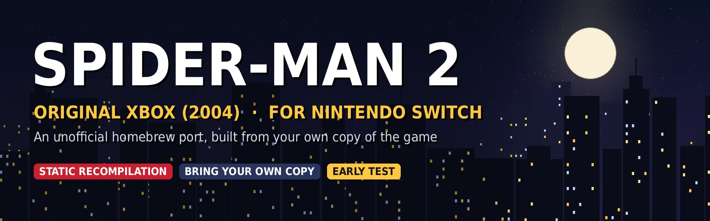
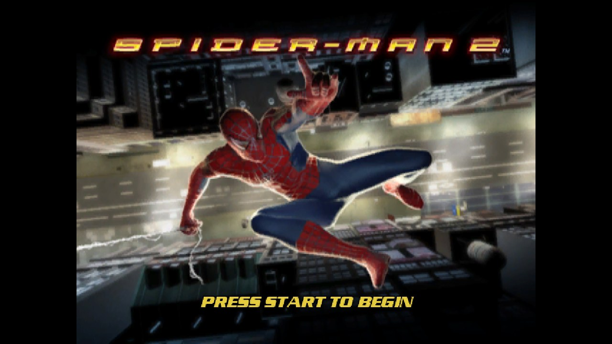
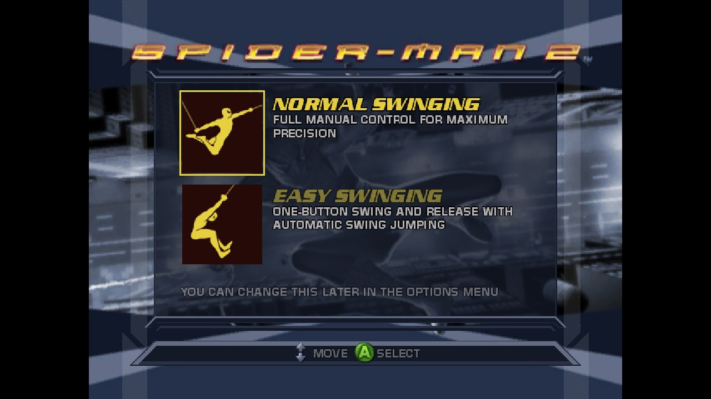
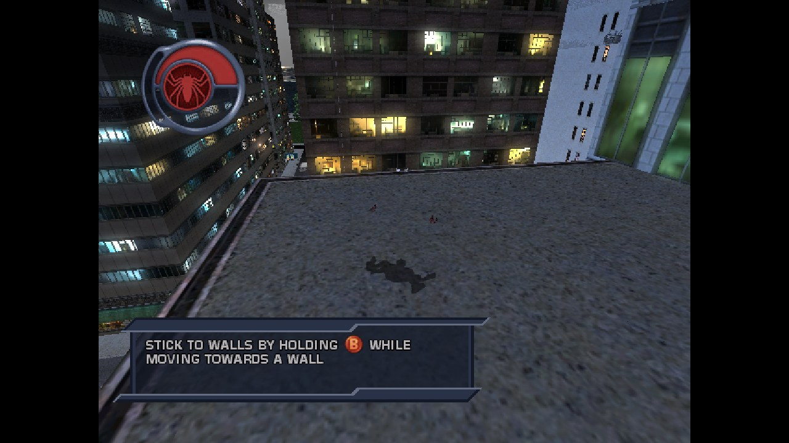
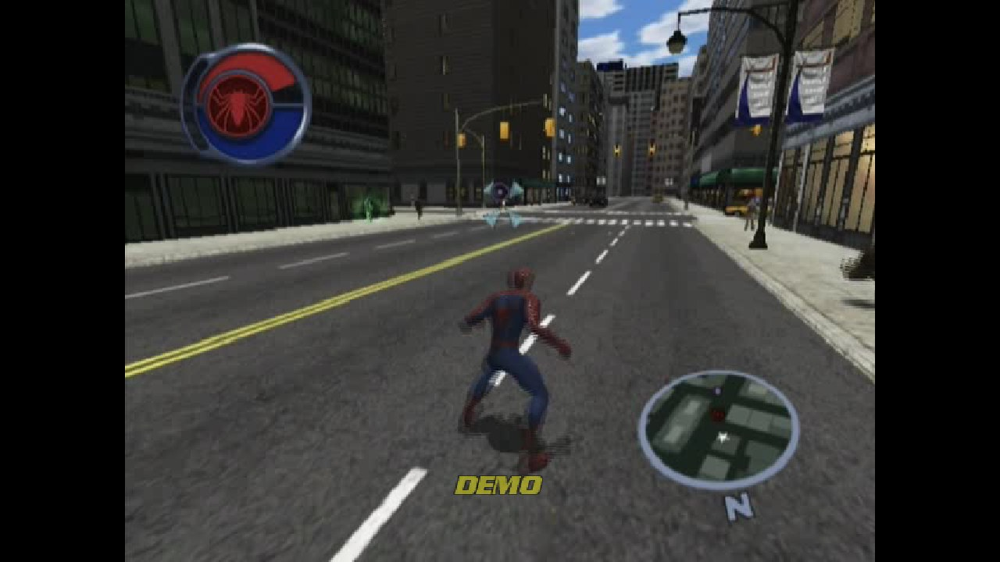
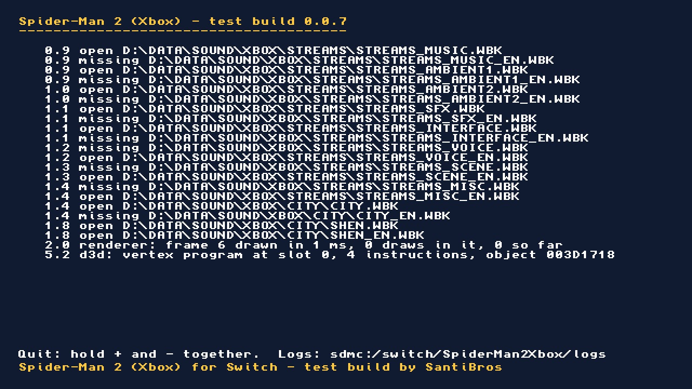
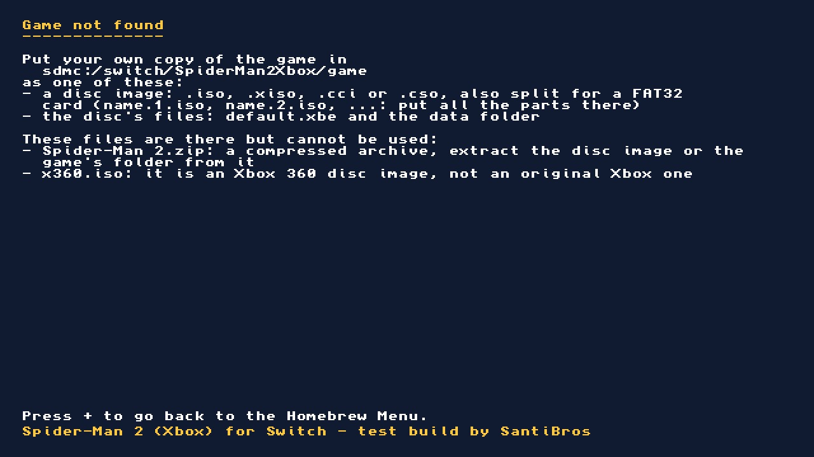

<div align="center">

[](README.md)
[](README.es.md)



# Spider-Man 2 (Xbox) for Nintendo Switch

**An unofficial homebrew port of the original Xbox version of *Spider-Man 2* (Treyarch, 2004) to the Nintendo Switch.**<br>
The game's own code, recompiled ahead of time for the Switch's processor, with the Xbox's system rebuilt
around it. Bring your own copy of the game, build the port from it once, and swing through New York.

[](../../releases)


[](LICENSE)

[Install](#how-to-install) · [Controls](#controls) · [Status](#status) · [FAQ](#faq) · [Troubleshooting](docs/INSTALL.md#troubleshooting) · [Changelog](CHANGELOG.md) · [How it works](docs/TECHNICAL.md)

</div>

> [!IMPORTANT]
> **No game files are included, not in this repository and not in the releases.** You need your own
> copy of *Spider-Man 2* for the **original Xbox**, and you build the port from it on your computer
> (one command). Please don't ask for game files in issues, and never upload them, or the `.nro` you
> build, anywhere: it contains code made from the game.
>
> This port is for the **original Xbox version (2004)** only. The PlayStation 2, GameCube, PC, Game Boy
> Advance, Nintendo DS and PSP versions are different programs and don't work, and neither do the
> newer *Spider-Man* games.

> [!WARNING]
> **Early test build: not playable yet.** On the port's PC test build the game runs through its menus
> and cinematics into the city. On a Switch it has not yet got past its start in testing, and the
> picture is drawn by a slow CPU renderer, a still frame every few seconds. [Testers](#help-wanted-testers)
> are welcome.

> [!TIP]
> **New in 0.0.7**
> - **Your disc image works as it is**: `.iso` / `.xiso` (or a full disc dump), `.cci` and `.cso`, also
>   split into parts for a FAT32 SD card. Or the disc's files, as before.
> - **Clear messages** when something is wrong: an archive to extract, an Xbox 360 image, another
>   release of the game.
> - **Build it in one command** from your copy: `bash build.sh "Spider-Man 2.iso"`.
>
> All the details, and the fixes of 0.0.3 to 0.0.6, are in the [changelog](CHANGELOG.md).

## Screenshots

<table>
  <tr>
    <td width="50%"></td>
    <td width="50%"></td>
  </tr>
  <tr>
    <td align="center"><sub>The title screen</sub></td>
    <td align="center"><sub>Choosing the swing controls</sub></td>
  </tr>
  <tr>
    <td></td>
    <td></td>
  </tr>
  <tr>
    <td align="center"><sub>The first rooftop, with the HUD and a tutorial hint</sub></td>
    <td align="center"><sub>The game's attract demo, in the streets</sub></td>
  </tr>
  <tr>
    <td></td>
    <td></td>
  </tr>
  <tr>
    <td align="center"><sub>The port's start screen: what it is doing, until the game draws</sub></td>
    <td align="center"><sub>When no usable copy is found, it says what to put where</sub></td>
  </tr>
</table>

<p align="center"><sub>The game screenshots come from the port's PC test build, which runs the same recompiled code
and the same CPU renderer as the Switch build, with the Switch build's timing and screen layout (the game's
4:3 picture on the Switch's 1280×720 screen). The two port screens are drawn exactly as the Switch shows them.</sub></p>

## Features

- **The game's real code, recompiled, not emulated.** The 26,876 functions of the game's x86 code are
  translated to C++ ahead of time and compiled for the Switch's ARM processor. The Xbox's kernel,
  Direct3D 8, DirectSound and controller interfaces are rebuilt as native Switch code
  ([how it works](#how-it-works)).
- **Your copy in the format you have.** A disc image (`.iso` or `.xiso`, a trimmed XISO or a full disc
  dump), the compressed `.cci` (Cerbios) and `.cso` (StellarOS) images that Repackinator makes, any of
  them split into parts for a FAT32 card, or the files from the disc.
- **Built from your copy in one command.** `build.sh` checks that your copy is the supported release,
  recompiles it and builds the `.nro`, with the SD card folder laid out.
- **Says what's wrong.** Missing data folder, an archive that needs extracting, an Xbox 360 image, another
  release of the game: the screen explains it in plain words.
- **Made for testing.** Until the game draws, the screen shows the newest lines of the log. The log
  reaches the SD card several times a second, so it survives a frozen console, and a status line every
  2 seconds says what each of the game's threads is doing. Crashes leave a report.
- **Controls mapped by position**, so the buttons the game shows are where your fingers expect them.
- **Fully offline.** The port doesn't use the network.

## What you need

| | What |
|---|---|
| **Console** | A Nintendo Switch, Switch OLED or Switch Lite running [Atmosphère](https://github.com/Atmosphere-NX/Atmosphere) with the Homebrew Menu. Use emuMMC and keep a backup of your SD card. |
| **Game** | Your own *Spider-Man 2* for the **original Xbox**, the release whose `default.xbe` has the SHA-1 `853bcb253c5baea2d7e2d9b59e5888b4c87bb402` (title ID `4156002B`, version 4). As a disc image or as the disc's files, about 1.7 GB. `build.sh` checks it for you. |
| **Computer** | Linux, or Windows 10/11 with WSL (the Linux that Windows can install), to build the port once. About 2 GB of space and 10 to 30 minutes. macOS is untested. |
| **SD card** | About 2 GB free. FAT32 or exFAT (on FAT32, a disc image over 4 GB must be split). |

## How to install

> [!TIP]
> **New to Switch homebrew?** First set up your console with custom firmware (Atmosphère) and the
> Homebrew Menu: the community guide [switch.hacks.guide](https://switch.hacks.guide/) explains it step by
> step. Unsure what XBE, XISO, CCI or WSL mean? See the [glossary](docs/INSTALL.md#glossary).

1. **Get your game as files.** A disc image of your own disc, or the files from it. PC DVD drives can't
   read original Xbox discs: [how to get them](docs/INSTALL.md#getting-your-game).
2. **Build the port.** Download `SpiderMan2-NX-0.0.7.zip` from the [Releases](../../releases) page and
   unzip it on your computer, then run one command in its folder, pointing at your game:
   ```sh
   bash build.sh "/path/to/Spider-Man 2.iso"
   ```
   The first time, install the tools it needs (about 10 minutes, once): [step by step](docs/INSTALL.md#building-the-port).
3. **Copy to the SD card.** Copy the `out/sd/switch` folder it made to the root of your SD card. Then copy
   your game into `switch/SpiderMan2Xbox/game/`: your disc image (all its parts, if it is split), or
   `default.xbe` and the `data` folder.
4. **Play.** Hold **R** while you launch any game to open the Homebrew Menu, then choose
   **Spider-Man 2 (Xbox)**.

> [!WARNING]
> Always open the Homebrew Menu with **R + a game** (title takeover). From the Album, homebrew only gets
> about 440 MB of memory, and the game needs about 1.3 GB.

<details>
<summary><b>What the folder looks like on the SD card</b></summary>

```
sd:/switch/SpiderMan2Xbox/
├── SpiderMan2Xbox.nro    the port you built (never share it: it holds code made from the game)
├── README.txt            the player's guide
├── game/                 YOUR game, one of:
│   ├── Spider-Man 2.iso      a disc image (.iso .xiso .cci .cso), or all the parts of a split one
│   └── default.xbe, data/    or the files from the disc
├── hdd/                  the Xbox hard disk: your saves (made at the first start)
└── logs/                 sm2_NNN.log and crash.txt: attach them to bug reports
```

</details>

The [full install guide](docs/INSTALL.md) covers getting your game, building on Windows with WSL, updating
and [troubleshooting](docs/INSTALL.md#troubleshooting).

### Updating

Build the new version the same way, then copy its `out/sd/switch` folder over the old one. Your `game/`
and `hdd/` folders stay as they are.

## Controls

The game shows the Xbox controller's buttons. They are mapped by **position**, so the button the game
asks for is where it is on the Xbox controller:

| Xbox | Switch | | Xbox | Switch |
|---|---|---|---|---|
| A (bottom) | **B** | | Left / right trigger | **ZL** / **ZR** |
| B (right) | **A** | | White / black button | **L** / **R** |
| X (left) | **Y** | | Start / Back | **+** / **−** |
| Y (top) | **X** | | Sticks, D-pad | the same |

Hold **+ and −** together for one second to quit. Hold **L** while the port starts to turn the sound off
(to test whether a problem comes from the sound).

## Status

> [!NOTE]
> **Early test.** This is the first public build. It has not yet been played on a Switch: back up your SD
> card and use emuMMC.

| Part | State |
|---|---|
| The game's code on the Switch's processor | ✅ Recompiled and compiled; runs into the city on the ARM test build |
| Reading your copy: disc images and files | ✅ All formats checked byte for byte against the extracted files, on PC and ARM |
| Starting on a Switch | 🧪 It finds the game and starts it; it froze right after in 0.0.3. 0.0.4 to 0.0.7 fix the causes found and log enough to find the next one |
| Picture | ⚠️ A slow CPU renderer for now: a still frame every few seconds. The Switch's GPU comes later |
| Menus, cinematics, the city | ✅ On the PC test build |
| Sound | 🧪 Through the Switch's speakers and headphones; untested on a console |
| Controls | 🧪 Mapped, untested on a console |
| Saves | 🧪 In `hdd/` on the SD card; untested on a console |
| Language | English (the game's Spanish texts are on the disc; a language option is planned) |
| Online | ❌ None: the port doesn't use the network |

**Known issues**
- Spider-Man's body isn't drawn yet when you play (his shadow is), though it is in the game's own demo. The
  sky of the opening cinematic is grey noise.
- The logo movies play but aren't drawn.
- Only the release above is supported: other releases need their own recompiler config.

See the [changelog](CHANGELOG.md) for what changed in each version.

## Help wanted: testers

The port is tested on a PC build that runs the same recompiled code and on the ARM build in an emulator.
What's missing is real consoles. Reports in English or Spanish help most, with the `logs` folder:

| What | How to help |
|---|---|
| 🎮 **Does it start?** | Build it, start it, and tell what the screen shows. A photo of the start screen says how far it got. |
| 🧊 **Freezes** | If the console freezes, take a photo, restart, and send the `logs` folder and the newest files in `atmosphere/crash_reports/`. Then try once holding **L** at start (no sound). |
| 💿 **Your image format** | If your `.cci`, `.cso` or split image isn't accepted, send the log: it says why. |

Open an [issue](../../issues/new/choose): the form asks for everything needed.

## FAQ

<details>
<summary><b>Is this an emulator?</b></summary>

**No, at least not for the game's code.** An emulator reads the game's x86 instructions one by one while it
runs (or translates them on the fly). This port uses **static recompilation**: every function of the game's
`default.xbe` is translated to C++ once, on your computer, and that C++ is compiled into a normal Switch
program. The Switch then runs the game's logic as its own code.

What the game asks the Xbox for (the kernel, files, threads, Direct3D 8, DirectSound, the controllers) is
answered by the port's own code, written for the Switch. The one part that still works like an emulator is
the picture: the game's Direct3D commands are drawn by a software renderer on the CPU for now, which is why
it is slow. See [How it works](docs/TECHNICAL.md).
</details>

<details>
<summary><b>Why is there no ready-to-play download?</b></summary>

Because the `.nro` *is* the game's code, translated to the Switch's processor. Sharing it would be sharing
the game. So the releases hold the port's source and the builder, and you make the `.nro` from your own copy
on your computer. It's one command, and the builder checks your copy first. Keep the `.nro` you make for
yourself.
</details>

<details>
<summary><b>Does it work with the PlayStation 2, GameCube or PC version?</b></summary>

No. Those are different programs: each version of *Spider-Man 2* (2004) was built for its own console, and
the PC version is a different game altogether. This port runs the **original Xbox** version only. The newer
*Spider-Man* games (for example *Marvel's Spider-Man 2*, 2023) are unrelated.
</details>

<details>
<summary><b>Which release of the Xbox game works?</b></summary>

The one whose `default.xbe` has the SHA-1 `853bcb253c5baea2d7e2d9b59e5888b4c87bb402` (title ID `4156002B`,
version 4), in English. `build.sh` checks it and tells you if yours is different. The recompiled code
matches that one file exactly; another release (another region, for example) would need its own recompiler
config. If you have another release, an issue with its SHA-1 (the builder prints it) helps.
</details>

<details>
<summary><b>Where do I get the game files?</b></summary>

From your own disc. This project can't help with that, and issues asking for game files will be closed.
[Getting your game](docs/INSTALL.md#getting-your-game) explains the usual ways to make a copy of your own disc.
</details>

<details>
<summary><b>Which disc image formats work?</b></summary>

- **`.iso` / `.xiso`**: a trimmed XISO (what `extract-xiso` makes) or a full disc dump (the video partition
  first, as Redump's are).
- **`.cci`**: the compressed images Repackinator makes for Cerbios.
- **`.cso`**: the compressed images (version 2, LZ4) Repackinator and `ciso` make for StellarOS.
- Any of them **split** into parts (`name.1.iso`, `name.2.iso`, ... or `.1.cci`, `.1.cso`): put all the parts
  in the folder.
- Or the **files** from the disc: `default.xbe` and the `data` folder.

Not read: `.zip`, `.7z` or `.rar` archives (extract them first), Xbox 360 images, and the old zlib CSO
(version 1) made for the PSP.
</details>

<details>
<summary><b>My SD card is FAT32 and my image is over 4 GB</b></summary>

FAT32 can't hold a file over 4 GB. Use a split image (Repackinator splits by itself, and the port reads the
parts as one), a compressed `.cci` or `.cso` (this game fits in about 1.5 GB), or the disc's files. Or format the card as exFAT.
</details>

<details>
<summary><b>Why does the picture update so slowly?</b></summary>

For now the game's graphics are drawn by a software renderer on the CPU, one still picture every few seconds,
while the game runs at its own speed in between. It was the quickest way to see the game on the screen and to
test everything else. A renderer on the Switch's GPU is the next big step.
</details>

<details>
<summary><b>Can I play in Spanish?</b></summary>

Not yet: this release starts in English. The game's Spanish texts are on the disc (its voices are English
only), and an option for the language is planned.
</details>

<details>
<summary><b>Does the port go online? Can I get banned?</b></summary>

The port never connects to the internet. Running any homebrew needs custom firmware, which is against
Nintendo's terms and can get a console banned from Nintendo's online services. Running homebrew on an emuMMC
and keeping your SD card backed up is the usual advice.
</details>

<details>
<summary><b>Where is my save, and how do I back it up?</b></summary>

The port keeps an Xbox hard disk in `switch/SpiderMan2Xbox/hdd/`, and the game saves there as it would on the
Xbox. Copy that folder somewhere safe from time to time.
</details>

<details>
<summary><b>Can I build it on Windows without WSL, or on a Mac?</b></summary>

The builder is a Linux shell script, and WSL is the easy way on Windows: [step by step](docs/INSTALL.md#on-windows-with-wsl).
devkitPro also runs on macOS, but the builder hasn't been tried there.
</details>

## How it works

The game is the x86 program `default.xbe`, made for the Xbox's Pentium III and its NV2A graphics chip. The port:

1. **Recompiles the game's code ahead of time** with the [Xbox XBE Recomp](https://github.com/TGP482/XboxXBE-Recomp)
   SDK's `xbe_recomp`: every function becomes C++, compiled for the Switch's ARM CPU with devkitA64.
2. **Rebuilds the Xbox's system around it**: the kernel's 120 functions the game imports, threads and
   timers, files (the disc's or the disc image's), Direct3D 8 with its push buffers and vertex programs,
   DirectSound and the controllers, as native code.
3. **Fits the Xbox's 4 GB address space** into the memory a Switch homebrew program can have, in 256 MB slices.
4. **Draws** the game's Direct3D commands with a software renderer for now, and shows them on the Switch's screen.

More in [docs/TECHNICAL.md](docs/TECHNICAL.md): the recompiler, the Switch layer, the disc image formats, the
test builds and the source layout.

## Building from source

`build.sh` does everything: it builds the PC tools, recompiles your `default.xbe` and builds the `.nro` with
[devkitPro](https://devkitpro.org/wiki/Getting_Started)'s `switch-dev` tools:

```sh
bash build.sh "/path/to/your/Spider-Man 2.iso"     # or the game's folder, or default.xbe
```

The result is `build-switch/SpiderMan2Xbox.nro`, laid out for the SD card in `out/sd/`.
[docs/BUILDING.md](docs/BUILDING.md) has the details, the PC test build used for development, the tests, and
how a release is made.

## Credits

Standing on the shoulders of others:

- **Treyarch** and **Activision**, who made the game. Please support the original.
- [**Xbox XBE Recomp**](https://github.com/TGP482/XboxXBE-Recomp) by TGP482: the recompiler and the Xbox runtime
  this port is built on (in `sdk/`, with the changes listed in [docs/TECHNICAL.md](docs/TECHNICAL.md)).
- [**Zydis**](https://github.com/zyantific/zydis) (x86 decoding) and [**toml++**](https://github.com/marzer/tomlplusplus),
  used by the recompiler.
- [**XbSymbolDatabase**](https://github.com/Cxbx-Reloaded/XbSymbolDatabase), [**Cxbx-Reloaded**](https://github.com/Cxbx-Reloaded/Cxbx-Reloaded)
  and [**xemu**](https://github.com/xemu-project/xemu): finding the XDK's functions, and the reference for how the
  Xbox and its GPU behave.
- [**libnx**](https://github.com/switchbrew/libnx) and the switchbrew community, [**devkitPro**](https://devkitpro.org)
  (devkitA64, switch-tools) and [**Atmosphère**](https://github.com/Atmosphere-NX/Atmosphere).
- The disc image formats: [**extract-xiso**](https://github.com/XboxDev/extract-xiso),
  [**Repackinator** and XboxToolkit](https://github.com/Team-Resurgent/Repackinator) by Team Resurgent (CCI), and
  [**ciso**](https://github.com/antangelo/ciso) by antangelo (CSO), whose formats the port reads; LZ4 by Yann Collet.

Full list with licenses: [THIRD_PARTY.md](THIRD_PARTY.md).

## License

The port's own code (`switch/`, `src/`, `tools/`, `config/`, `build.sh`) is under the [MIT License](LICENSE). The
SDK in `sdk/` keeps its own MIT license ([sdk/LICENSE](sdk/LICENSE)), and the other third-party code its own
([THIRD_PARTY.md](THIRD_PARTY.md)). The game is not included and is not covered by these licenses in any way.

## Disclaimer

This is an unofficial fan project. It is not affiliated with, endorsed or sponsored by Activision, Treyarch,
Marvel, Sony Pictures, Microsoft or Nintendo. *Spider-Man* is a trademark of Marvel; Xbox is a trademark of
Microsoft; Nintendo Switch is a trademark of Nintendo. No game code or data is distributed here: you need your
own copy of the game, and what you build from it is for you only.

Running homebrew requires custom firmware, which is against Nintendo's terms of service and can get a console
banned from online services; that decision is yours. The software is provided as is, without warranty (see
[LICENSE](LICENSE)).

---

<div align="center">

A project by **SantiBros** · If you like it, star the repo ⭐ and share it

</div>
